<div align="center">

<h1>👽 ALIEN CLIENT</h1>

<strong>ONE CLIENT. YOUR GAME. YOUR STYLE.</strong>

<p>Um client customizável para Minecraft Java 1.8.9, com interface renovada,<br>
cosméticos, HUD, céu personalizado, ferramentas de combate opcionais e métricas reais de desempenho.</p>

<p>
  
  
  
  
</p>

<p>
  <a href="https://github.com/AttackAlien/Alien-Client/actions/workflows/unified-client-ci.yml"></a>
  <a href="https://github.com/AttackAlien/Alien-Client/actions/workflows/forge-ci.yml"></a>
</p>

<a href="#-comece-a-jogar"><strong>COMECE A JOGAR</strong></a>
&nbsp; · &nbsp;
<a href="#-o-que-tem-no-alien"><strong>RECURSOS</strong></a>
&nbsp; · &nbsp;
<a href="#-galeria"><strong>GALERIA</strong></a>
&nbsp; · &nbsp;
<a href="#-desenvolvimento"><strong>DESENVOLVIMENTO</strong></a>

<br><br>

<a href="captures/atual/unified/91-interactive-main-menu.png">
  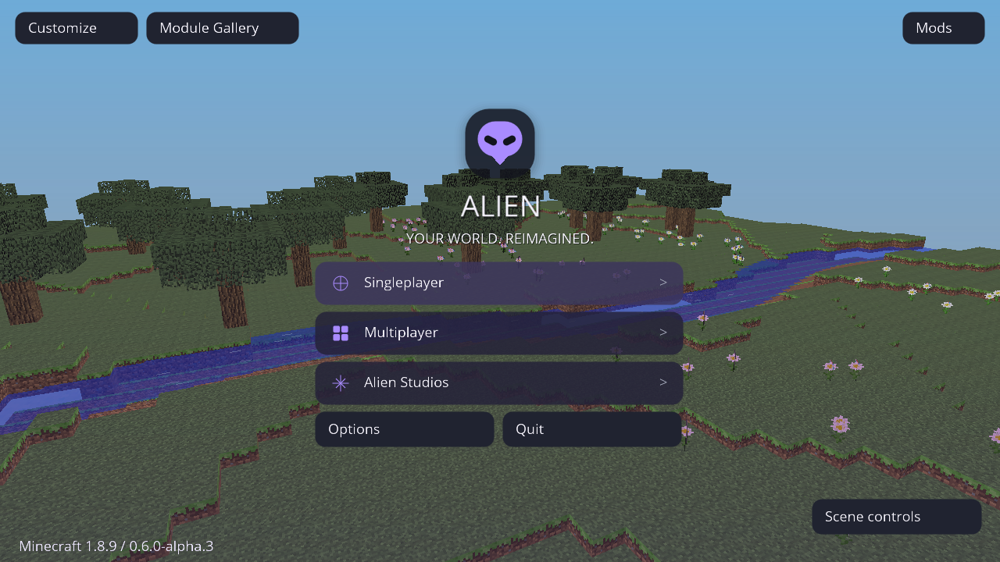
</a>

<sub>Imagem real capturada no Minecraft 1.8.9 com Forge e Java 8. Mais capturas na <a href="captures/README.md">galeria de validação</a>.</sub>

</div>

---

## ✦ O que é o Alien Client?

O **Alien Client Unified** reúne personalização visual e ferramentas configuráveis em **um único client**, sem precisar escolher entre arquivos “Legit” e “Full”. O redesign **0.4.0-alpha.2**, o Combat Studio com autorização por sessão e o Performance Engine V2 já fazem parte da `main`.

Nesta branch, a **0.6.0-alpha.2** acrescenta menu 3D interativo, Orbit/galeria de módulos, biblioteca local de perfis, oito estilos de céu nomeados e Mist, Afterglow, Radiance, Target ESP, Bokeh, Hand Movement, Name Tags e Zoom. Preserva HUD/Full, cosméticos, trilhas e Scene Studio dos PRs #15/#16/#17. **Minecraft continua 1.8.9**. [PR #18](https://github.com/AttackAlien/Alien-Client/pull/18), sem merge. [Recursos/limites](docs/INTERACTIVE-STUDIO.md) · [Validação](docs/INTERACTIVE-STUDIO-VALIDATION.md) · [Build de teste](downloads/v0.6.0-alpha.2/).

A proposta é simples: **deixar o Minecraft com a sua cara**, com controles por módulo, perfis salvos e uma interface pensada para ser prática durante o jogo.

> [!NOTE]
> **Projeto em fase alpha.** O client jogável é para **Minecraft Java 1.8.9 + Forge 11.15.1.2318 + Java 8**. O launcher separado está em desenvolvimento; ainda não é uma versão estável publicada.

## ✦ O que tem no Alien

| | |
|:--|:--|
| **🎛️ ClickGUI & Theme Studio** <br> Pesquisa de módulos, favoritos, atalhos, temas, cores HSV/RGBA/HEX, escala e blur opcional. | **🧩 HUD Studio Ultimate** <br> Target HUD animado, crosshair, teclas, CPS, armadura e indicadores reais; arraste, escala, opacidade, temas e presets. |
| **🦊 Cosmetic Studio** <br> Capas animadas, acessórios 3D, asas, emblemas e looks salvos. | **🌌 World & Sky Studio** <br> Céu procedural, panoramas/cubemaps, galeria PNG, favoritos, neblina e clima visual local. |
| **⚔️ Combat Studio** <br> Mira/clique, Aimbot, Auto Food, Auto Potion, Auto Sprint, Auto Bridge e spin de câmera, com controles individuais no Unified. | **📊 Performance Engine V2** <br> Histórico de frames, média, P95/P99, contador de picos e ajuste adaptativo opcional para os efeitos do Alien. |
| **✨ Particle Studio** <br> Diamond, pétalas, faíscas e orbes, com bordas suaves, brilho, duas cores, movimento e duração configuráveis. | **🎨 Presets de partículas** <br> PvP clean, Cinematic glow e Sakura petals, com orçamento limitado e persistência nos perfis. |

> [!IMPORTANT]
> **Combat não é ativado automaticamente em multiplayer por um perfil salvo.** É necessária autorização explícita para cada sessão/conexão. Respeite as regras de cada servidor. O Alien **não** oferece silent aim, fake anti-aim ou bypass de anticheat.

## ✦ Galeria

[Assistir ao vídeo real completo (4min48s) ou ao GIF de prévia (2min59s)](captures/video-atual/README.md).

<table>
  <tr>
    <td width="50%" align="center"><a href="captures/atual/unified/125-gallery-scene-effects.png">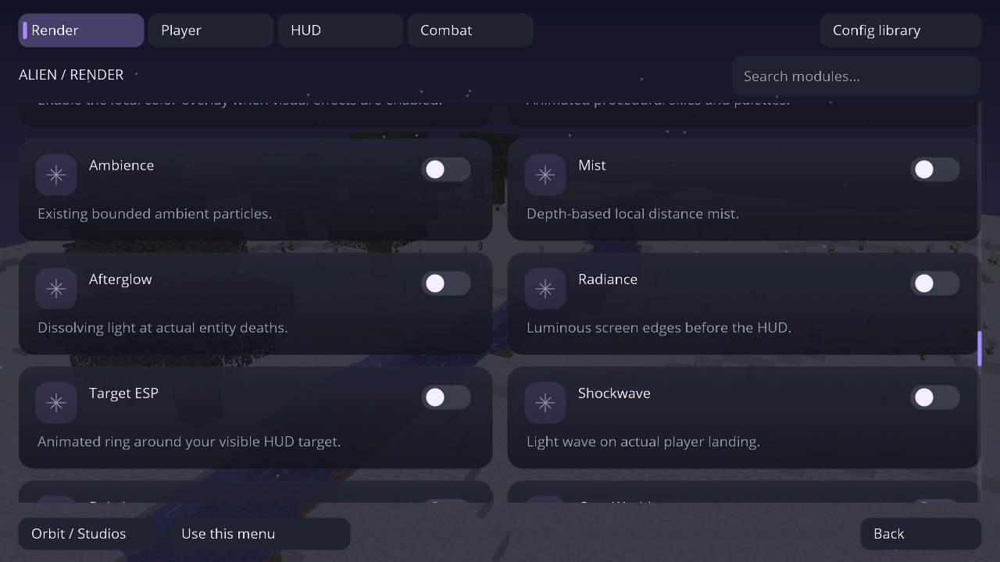</a><br><b>Galeria de módulos</b></td>
    <td width="50%" align="center"><a href="captures/atual/unified/119-living-sky-controls.png">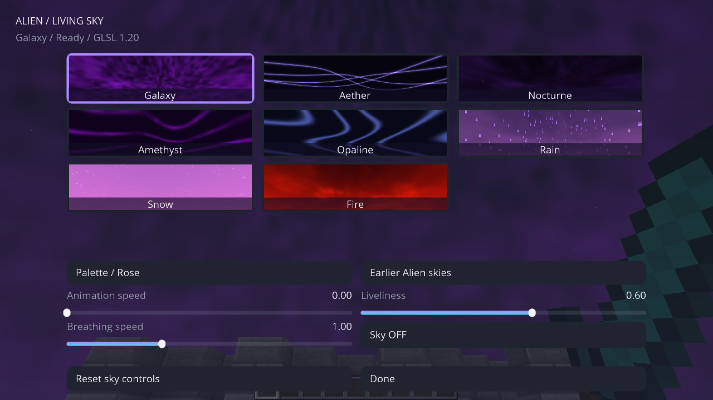</a><br><b>Estilos de céu e prévias reais</b></td>
  </tr>
  <tr>
    <td width="50%" align="center"><a href="captures/atual/unified/74-cyberspace-world.png">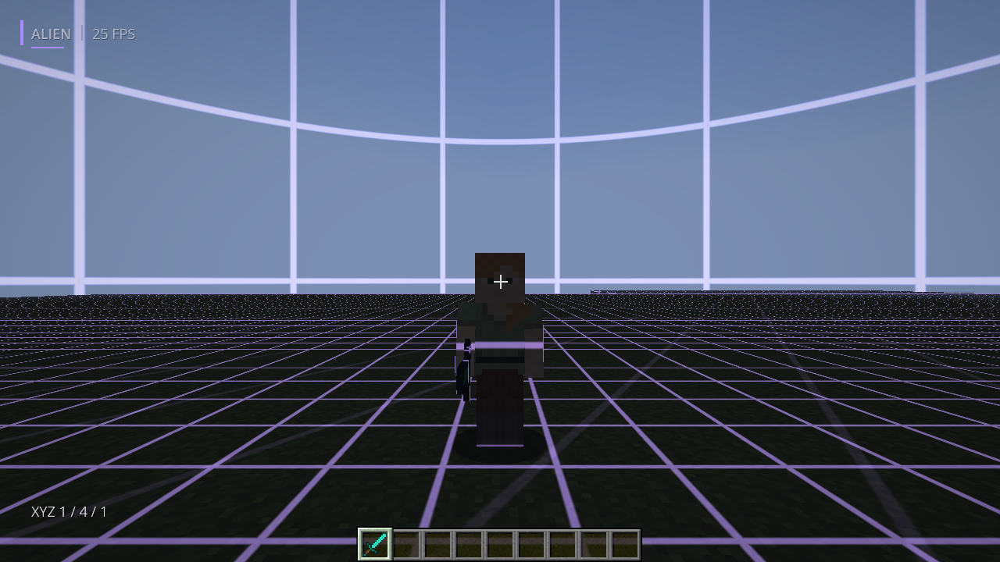</a><br><b>Cyberspace</b><br><sub>Grade real em terreno, personagens e céu</sub></td>
    <td width="50%" align="center"><a href="captures/atual/unified/79-blackhole-sky.png">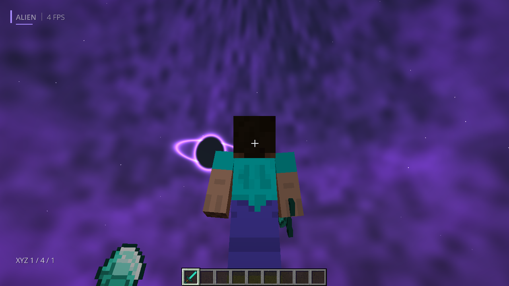</a><br><b>Oito céus animados</b><br><sub>Presets procedurais originais Alien</sub></td>
  </tr>
  <tr>
    <td width="50%" align="center">
      <a href="captures/atual/unified/66-ribbon-trail-and-cape-moving.png">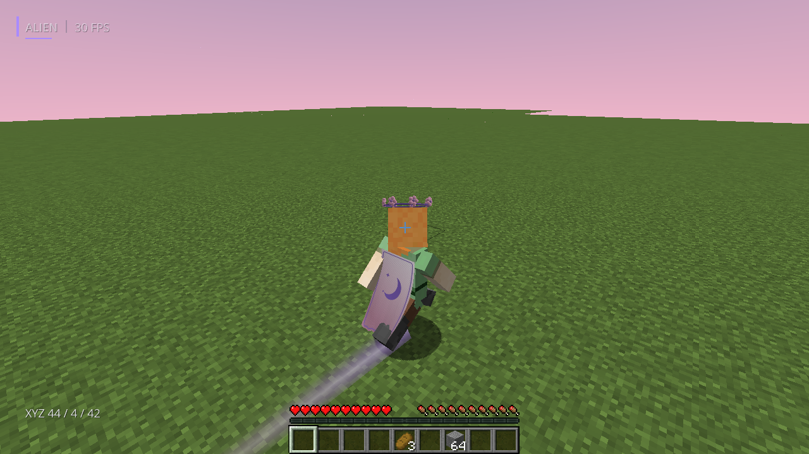</a><br>
      <b>Trilhas Ribbon e capa com inércia</b><br>
      <sub>Movimento real, bordas suaves e tecido CC0</sub>
    </td>
    <td width="50%" align="center">
      <a href="captures/atual/unified/70-sakura-cosmetic-studio.png">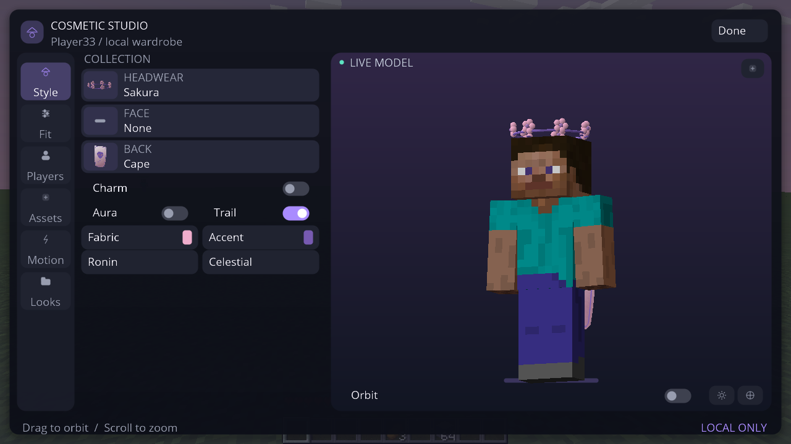</a><br>
      <b>Headwear refinado</b><br>
      <sub>Flores volumétricas e detalhes em malhas curvas</sub>
    </td>
  </tr>
  <tr>
    <td width="50%" align="center">
      <a href="captures/atual/unified/40-hud-ultimate-pvp-live.png">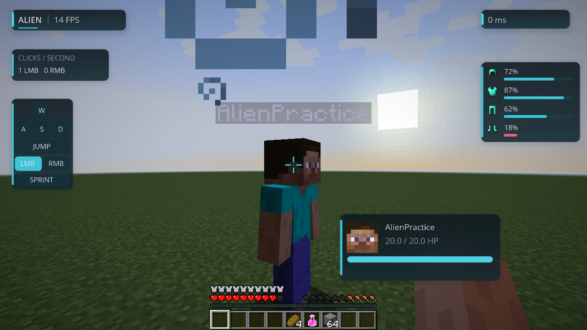</a><br>
      <b>HUD Studio Ultimate</b><br>
      <sub>Avatar, HP animado, mira, teclas, CPS e armadura reais</sub>
    </td>
    <td width="50%" align="center">
      <a href="captures/atual/unified/59-particles-cinematic-live.png">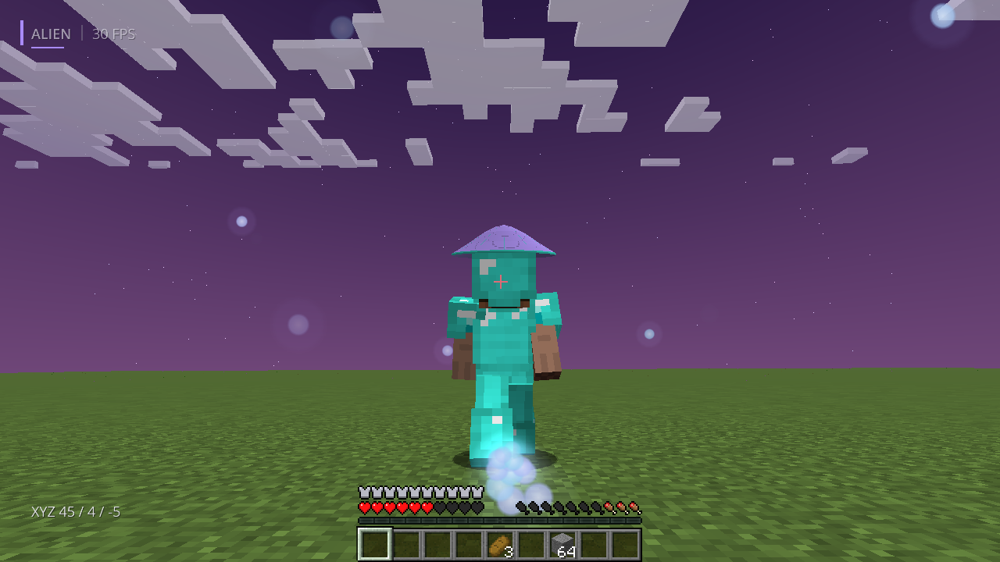</a><br>
      <b>Partículas aprimoradas</b><br>
      <sub>Contornos suaves, duas cores e brilho configurável</sub>
    </td>
  </tr>
  <tr>
    <td width="50%" align="center">
      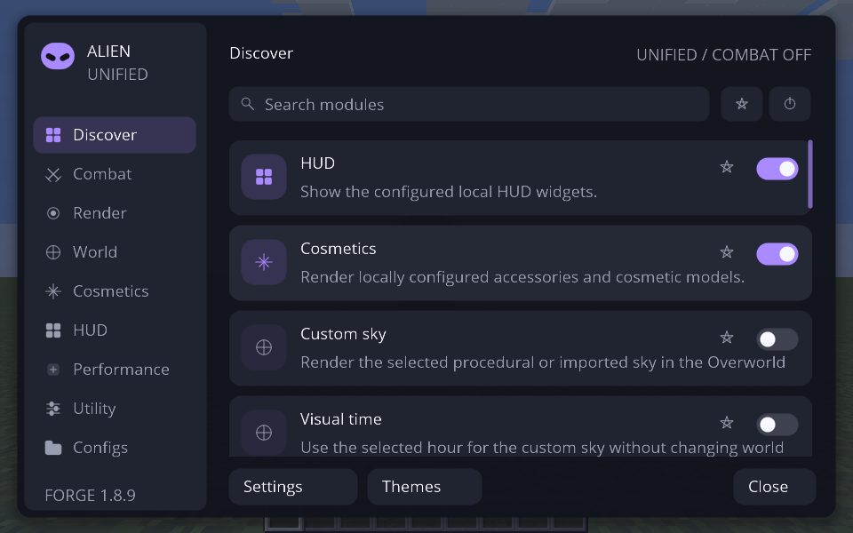<br>
      <b>ClickGUI</b><br>
      <sub>Personalização e controles</sub>
    </td>
    <td width="50%" align="center">
      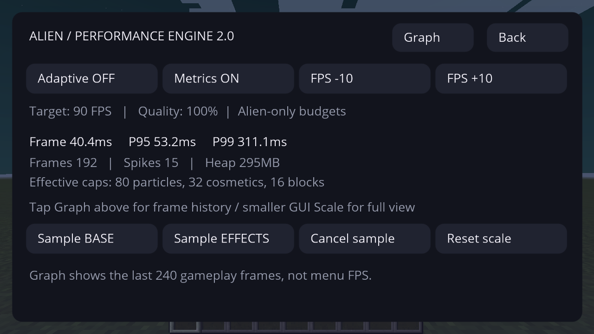<br>
      <b>Performance Engine V2</b><br>
      <sub>Frame times, métricas e qualidade adaptativa</sub>
    </td>
  </tr>
  <tr>
    <td align="center">
      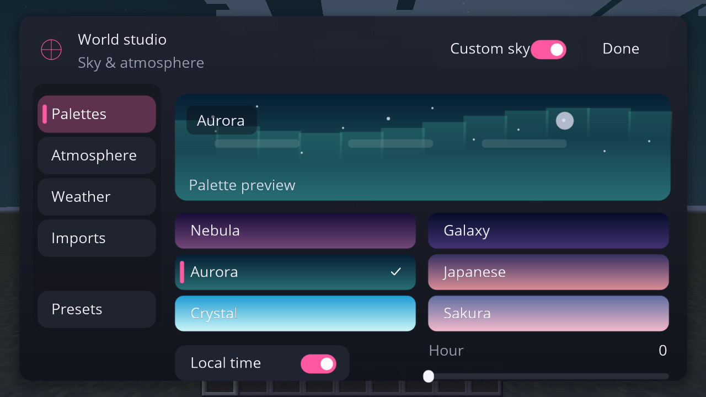<br>
      <b>World & Sky Studio</b><br>
      <sub>Céu, cores e atmosfera</sub>
    </td>
    <td align="center">
      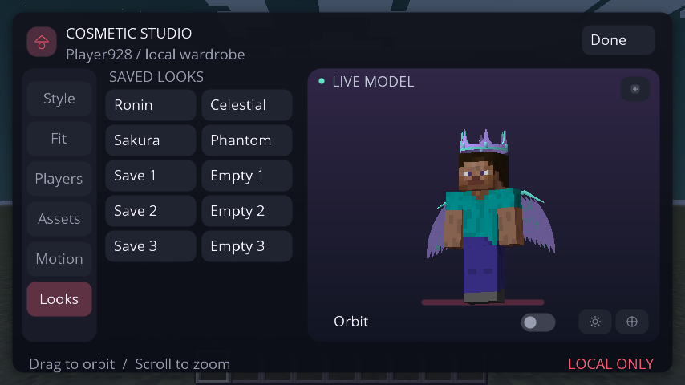<br>
      <b>Cosmetic Studio</b><br>
      <sub>Looks, capas e acessórios</sub>
    </td>
  </tr>
</table>

<details>
<summary><strong>Ver mais capturas — HUD, Combat Studio, cosméticos e efeitos</strong></summary>

<br>

| HUD Editor | Combat Studio |
|:--:|:--:|
| 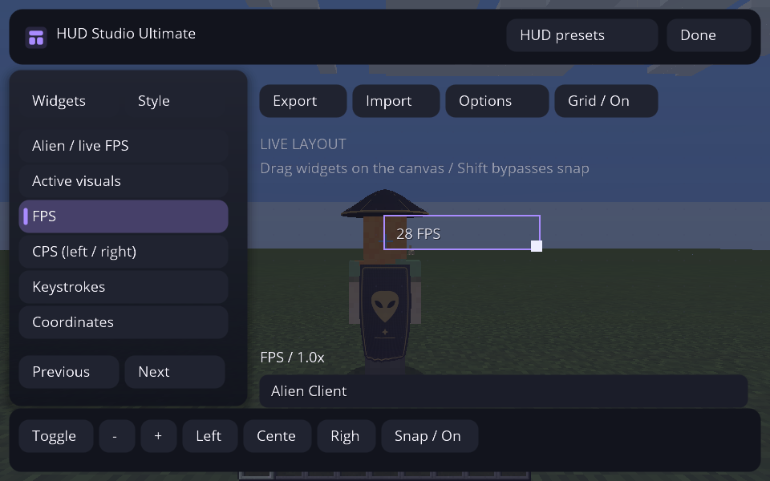 | 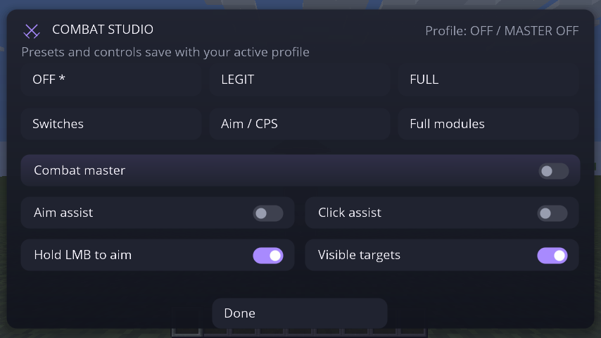 |

| HUD e partículas no mundo | Capa animada |
|:--:|:--:|
| 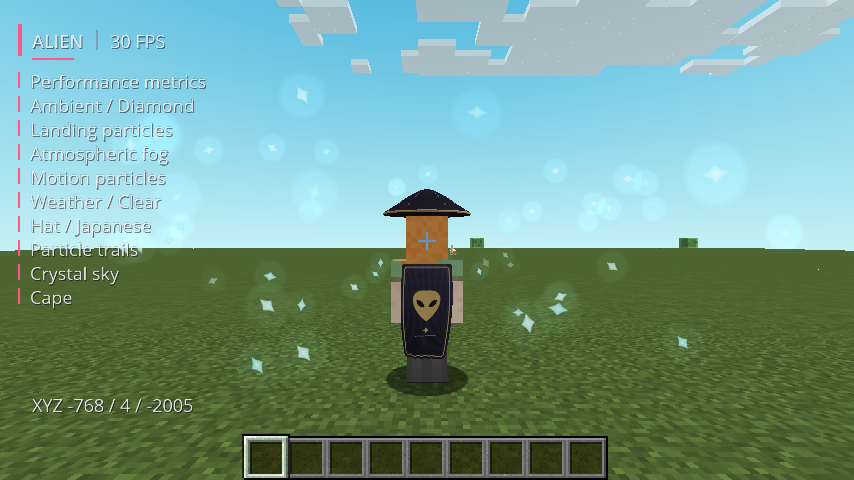 | 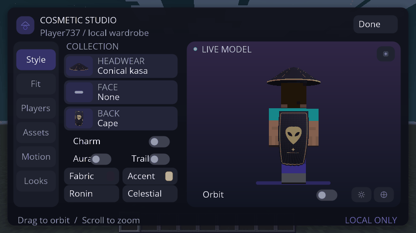 |

[**Abrir a galeria completa de imagens reais →**](captures/README.md)

</details>

## ✦ Comece a jogar

### Opção A — Alien Launcher 0.3 *(alpha para Windows x64)*

A interface 0.3 traz navegação lateral, cenário do client, controles escuros e configurações separadas. O launcher incorpora o **Unified 0.6.0-alpha.2**, instala Forge/Java em uma pasta isolada e verifica a integridade do client antes de abri-lo. Inclui seleção de Java 8, RAM/perfis persistentes, cancelar, sair da conta e diagnóstico. O seletor oferece **Alien em Forge 1.8.9** ou **Minecraft Vanilla independente**; os módulos do Alien continuam exclusivos da versão 1.8.9.

**[→ Baixar o pacote portátil de teste](downloads/launcher/v0.3.0-alpha.2/README.md)** · [Capturas reais atuais](captures/launcher-atual/README.md) · [Validação e limites](docs/LAUNCHER-REDESIGN-0.3.md) · [PR #19](https://github.com/AttackAlien/Alien-Client/pull/19)

Extraia o ZIP inteiro e abra `AlienLauncher.exe`. O login exige uma conta Microsoft que possua Minecraft Java e o WebView2 Runtime. **Autenticação Microsoft interativa e gameplay num PC Windows físico ainda precisam de validação.** Este candidato incorpora o trabalho do PR #12; não é release estável e não foi mesclado na main.

### Opção B — Minecraft Forge + Alien Client

1. Instale o **Minecraft Java 1.8.9**, o **Forge 11.15.1.2318** e use **Java 8**.
2. Baixe o [**candidato testado 0.6.0-alpha.2**](downloads/v0.6.0-alpha.2/README.md) desta branch / PR #18.
3. Extraia `AlienClient-Unified-1.8.9.jar` do ZIP de instalação, ou baixe o JAR diretamente na mesma página.
4. Copie o JAR para a pasta `mods` da instalação Forge 1.8.9. **Remova outros JARs do Alien Client** desse perfil.
5. Entre em um mundo e aperte **Right Shift** para abrir a interface.

**[→ Guia de instalação e primeiro teste](docs/PRIMEIRO-TESTE-UNIFIED.md)** · **[→ Builds validados pelo GitHub Actions](https://github.com/AttackAlien/Alien-Client/actions/workflows/unified-client-ci.yml)**

> [!TIP]
> Use uma **instância separada** para testar outros mods e faça backup de `config/alien-client/`. O JAR é um **mod Forge**, não um executável independente. O download de artefatos do Actions normalmente exige login no GitHub.

## ✦ Performance com dados, não promessas

O **Performance Engine V2** registra tempos reais dos frames durante o jogo e exibe **média, P95, P99 e picos**. A opção **Adaptive Quality** controla somente os orçamentos de partículas, cosméticos e distância de efeitos do **Alien**, sem alterar automaticamente as opções gráficas do Minecraft Vanilla.

O benchmark BASE / EFFECTS permite comparar duas sessões no mesmo cenário. **Não prometemos aumento de FPS** sem uma medição controlada no seu computador.

[**→ Detalhes técnicos do Performance Engine V2**](docs/PERFORMANCE-ENGINE-V2.md)

## ✦ Desenvolvimento

O projeto usa **Java 8**, **Minecraft Forge 1.8.9** e **ForgeGradle**. Para compilar a edição Unified em um ambiente compatível:

```bash
git clone https://github.com/AttackAlien/Alien-Client.git
cd Alien-Client
git switch feature/interactive-studio-20261024
bash scripts/bootstrap.sh
./gradlew --no-daemon -Pedition=unified setupDecompWorkspace clean build
```

Saída esperada: `build/unified/libs/AlienClient-Unified-1.8.9.jar`. A integração contínua executa testes JUnit, verificações gráficas do Minecraft em ambiente Linux e inspeção de artefatos. A verificação do ZIP no Windows **não substitui** o teste jogando em um PC Windows real.

| Documentação | Links |
|:--|:--|
| Arquitetura e cliente unificado | [Unified & migração](docs/UNIFIED-CLIENT.md) · [Auditoria](docs/ARCHITECTURE-AUDIT.md) |
| Interface, mundos e cosméticos | [Studios V2](docs/STUDIOS-V2.md) · [Sky Studio](docs/SKY_STUDIO_ULTIMATE.md) · [Redesign](docs/UI-OVERHAUL.md) |
| Qualidade e compatibilidade | [CI](docs/CI.md) · [Testes e benchmarks](docs/BENCHMARKS.md) · [Desenvolvimento](docs/DEVELOPMENT.md) |
| Créditos e componentes externos | [Licenças de terceiros](docs/THIRD_PARTY.md) · [Revisão open source](docs/OPEN_SOURCE_REVIEW.md) |

As versões separadas **Legit/Full** em [downloads](downloads/README.md) são **históricas**. Para testar o desenvolvimento atual, use o [**Unified 0.6.0-alpha.2 validado nesta branch**](downloads/v0.6.0-alpha.2/README.md).

---

<div align="center">

<strong>ALIEN CLIENT</strong><br>
<sub>Made to customize. Built to evolve.</sub>

<br><br>

<a href="https://github.com/AttackAlien/Alien-Client/issues">Reportar um problema</a>
&nbsp; · &nbsp;
<a href="https://github.com/AttackAlien/Alien-Client/pulls">Acompanhar o desenvolvimento</a>
&nbsp; · &nbsp;
<a href="captures/README.md">Ver todas as capturas</a>

</div>
