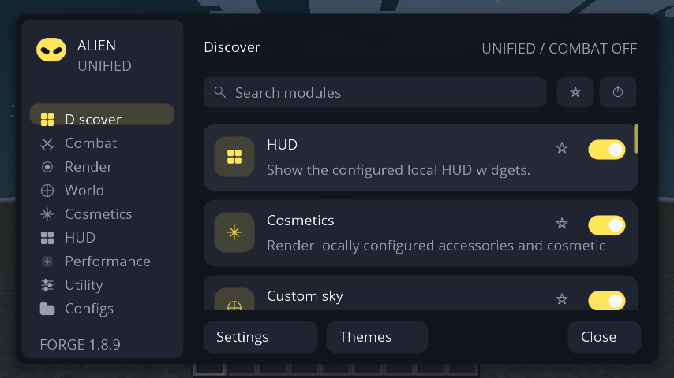

<div align="center">

<h1>👽 ALIEN CLIENT</h1>

<strong>ONE CLIENT. YOUR GAME. YOUR STYLE.</strong>

<p>Um client customizável para Minecraft Java 1.8.9, com interface renovada,<br>
cosméticos, HUD, céu personalizado, ferramentas de combate opcionais e métricas reais de desempenho.</p>

<p>
  
  
  
  
</p>

<p>
  <a href="https://github.com/AttackAlien/Alien-Client/actions/workflows/unified-client-ci.yml"></a>
  <a href="https://github.com/AttackAlien/Alien-Client/actions/workflows/forge-ci.yml"></a>
</p>

<a href="#-comece-a-jogar"><strong>COMECE A JOGAR</strong></a>
&nbsp; · &nbsp;
<a href="#-o-que-tem-no-alien"><strong>RECURSOS</strong></a>
&nbsp; · &nbsp;
<a href="#-galeria"><strong>GALERIA</strong></a>
&nbsp; · &nbsp;
<a href="#-desenvolvimento"><strong>DESENVOLVIMENTO</strong></a>

<br><br>

<a href="captures/atual/unified/09c-alien-menu-inside-world.png">
  
</a>

<sub>Imagem real capturada no Minecraft 1.8.9 com Forge e Java 8. Mais capturas na <a href="captures/README.md">galeria de validação</a>.</sub>

</div>

---

## ✦ O que é o Alien Client?

O **Alien Client Unified** reúne personalização visual e ferramentas configuráveis em **um único client**, sem precisar escolher entre arquivos “Legit” e “Full”. O redesign **0.4.0-alpha.2**, o Combat Studio com autorização por sessão e o Performance Engine V2 já fazem parte da `main`.

A proposta é simples: **deixar o Minecraft com a sua cara**, com controles por módulo, perfis salvos e uma interface pensada para ser prática durante o jogo.

> [!NOTE]
> **Projeto em fase alpha.** O client jogável é para **Minecraft Java 1.8.9 + Forge 11.15.1.2318 + Java 8**. O launcher separado está em desenvolvimento; ainda não é uma versão estável publicada.

## ✦ O que tem no Alien

| | |
|:--|:--|
| **🎛️ ClickGUI & Theme Studio** <br> Pesquisa de módulos, favoritos, atalhos, temas, cores HSV/RGBA/HEX, escala e blur opcional. | **🧩 HUD Studio** <br> Widgets de FPS, teclas, inventário e outras informações, com arraste, tamanho e alinhamento personalizáveis. |
| **🦊 Cosmetic Studio** <br> Capas animadas, acessórios 3D, asas, emblemas e looks salvos. | **🌌 World & Sky Studio** <br> Céu procedural, panoramas/cubemaps, galeria PNG, favoritos, neblina e clima visual local. |
| **⚔️ Combat Studio** <br> Presets OFF, LEGIT, FULL e CUSTOM para ajustar assistência de mira e de clique de maneira independente. | **📊 Performance Engine V2** <br> Histórico de frames, média, P95/P99, contador de picos e ajuste adaptativo opcional para os efeitos do Alien. |

> [!IMPORTANT]
> **Combat não é ativado automaticamente em multiplayer por um perfil salvo.** É necessária autorização explícita para cada sessão/conexão. Respeite as regras de cada servidor. O Alien **não** oferece silent aim, fake anti-aim ou bypass de anticheat.

## ✦ Galeria

<table>
  <tr>
    <td width="50%" align="center">
      <br>
      <b>ClickGUI</b><br>
      <sub>Personalização e controles</sub>
    </td>
    <td width="50%" align="center">
      <br>
      <b>Performance Engine V2</b><br>
      <sub>Frame times, métricas e qualidade adaptativa</sub>
    </td>
  </tr>
  <tr>
    <td align="center">
      <br>
      <b>World & Sky Studio</b><br>
      <sub>Céu, cores e atmosfera</sub>
    </td>
    <td align="center">
      <br>
      <b>Cosmetic Studio</b><br>
      <sub>Looks, capas e acessórios</sub>
    </td>
  </tr>
</table>

<details>
<summary><strong>Ver mais capturas — HUD, Combat Studio, cosméticos e efeitos</strong></summary>

<br>

| HUD Editor | Combat Studio |
|:--:|:--:|
|  |  |

| HUD e partículas no mundo | Capa animada |
|:--:|:--:|
|  |  |

[**Abrir a galeria completa de imagens reais →**](captures/README.md)

</details>

## ✦ Comece a jogar

### Opção A — Alien Launcher *(prévia em desenvolvimento)*

Estamos criando um launcher próprio para Windows, com interface dedicada, login Microsoft e instalação isolada. Ele inclui um seletor de versões: **Alien Client em Forge 1.8.9** ou **Minecraft Vanilla em outras versões**. Os módulos do Alien **ainda não foram portados** para 1.12.2, 1.16.5, 1.20.1 ou 1.21.x.

**[→ Acompanhar / testar a prévia do Alien Launcher (PR #12)](https://github.com/AttackAlien/Alien-Client/pull/12)**

O launcher é experimental e o fluxo completo de login e inicialização ainda requer testes em PCs reais. Não confunda builds de teste com uma release estável.

### Opção B — Minecraft Forge + Alien Client

1. Instale o **Minecraft Java 1.8.9**, o **Forge 11.15.1.2318** e use **Java 8**.
2. Abra [**Alien Client Unified CI**](https://github.com/AttackAlien/Alien-Client/actions/workflows/unified-client-ci.yml?query=branch%3Amain) e escolha uma execução **verde da `main`**.
3. Baixe o artefato `alien-unified-<run_id>` e extraia `distribution/AlienClient-Unified-1.8.9.jar`.
4. Copie o JAR para a pasta `mods` da instalação Forge 1.8.9. **Remova outros JARs do Alien Client** desse perfil.
5. Entre em um mundo e aperte **Right Shift** para abrir a interface.

**[→ Guia de instalação e primeiro teste](docs/PRIMEIRO-TESTE-UNIFIED.md)** · **[→ Builds validados pelo GitHub Actions](https://github.com/AttackAlien/Alien-Client/actions/workflows/unified-client-ci.yml)**

> [!TIP]
> Use uma **instância separada** para testar outros mods e faça backup de `config/alien-client/`. O JAR é um **mod Forge**, não um executável independente. O download de artefatos do Actions normalmente exige login no GitHub.

## ✦ Performance com dados, não promessas

O **Performance Engine V2** registra tempos reais dos frames durante o jogo e exibe **média, P95, P99 e picos**. A opção **Adaptive Quality** controla somente os orçamentos de partículas, cosméticos e distância de efeitos do **Alien**, sem alterar automaticamente as opções gráficas do Minecraft Vanilla.

O benchmark BASE / EFFECTS permite comparar duas sessões no mesmo cenário. **Não prometemos aumento de FPS** sem uma medição controlada no seu computador.

[**→ Detalhes técnicos do Performance Engine V2**](docs/PERFORMANCE-ENGINE-V2.md)

## ✦ Desenvolvimento

O projeto usa **Java 8**, **Minecraft Forge 1.8.9** e **ForgeGradle**. Para compilar a edição Unified em um ambiente compatível:

```bash
git clone https://github.com/AttackAlien/Alien-Client.git
cd Alien-Client
bash scripts/bootstrap.sh
./gradlew --no-daemon -Pedition=unified setupDecompWorkspace clean build
```

Saída esperada: `build/unified/libs/AlienClient-Unified-1.8.9.jar`. A integração contínua executa testes JUnit, verificações gráficas do Minecraft em ambiente Linux e inspeção de artefatos. A verificação do ZIP no Windows **não substitui** o teste jogando em um PC Windows real.

| Documentação | Links |
|:--|:--|
| Arquitetura e cliente unificado | [Unified & migração](docs/UNIFIED-CLIENT.md) · [Auditoria](docs/ARCHITECTURE-AUDIT.md) |
| Interface, mundos e cosméticos | [Studios V2](docs/STUDIOS-V2.md) · [Sky Studio](docs/SKY_STUDIO_ULTIMATE.md) · [Redesign](docs/UI-OVERHAUL.md) |
| Qualidade e compatibilidade | [CI](docs/CI.md) · [Testes e benchmarks](docs/BENCHMARKS.md) · [Desenvolvimento](docs/DEVELOPMENT.md) |
| Créditos e componentes externos | [Licenças de terceiros](docs/THIRD_PARTY.md) · [Revisão open source](docs/OPEN_SOURCE_REVIEW.md) |

As versões separadas **Legit/Full** em [downloads](downloads/README.md) são **históricas**. Para testar o desenvolvimento atual, prefira o **Unified da `main`**.

---

<div align="center">

<strong>ALIEN CLIENT</strong><br>
<sub>Made to customize. Built to evolve.</sub>

<br><br>

<a href="https://github.com/AttackAlien/Alien-Client/issues">Reportar um problema</a>
&nbsp; · &nbsp;
<a href="https://github.com/AttackAlien/Alien-Client/pulls">Acompanhar o desenvolvimento</a>
&nbsp; · &nbsp;
<a href="captures/README.md">Ver todas as capturas</a>

</div>
