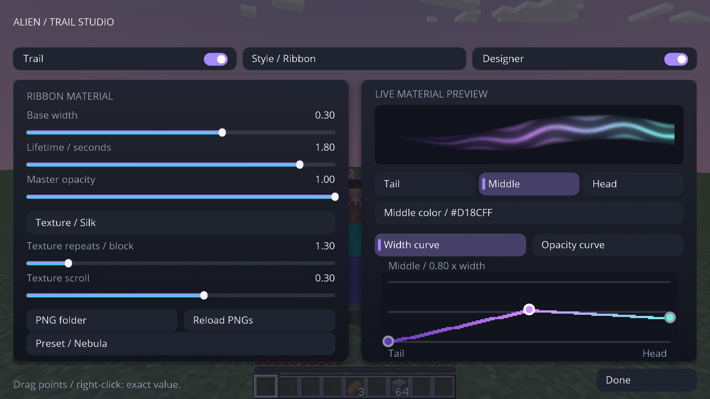
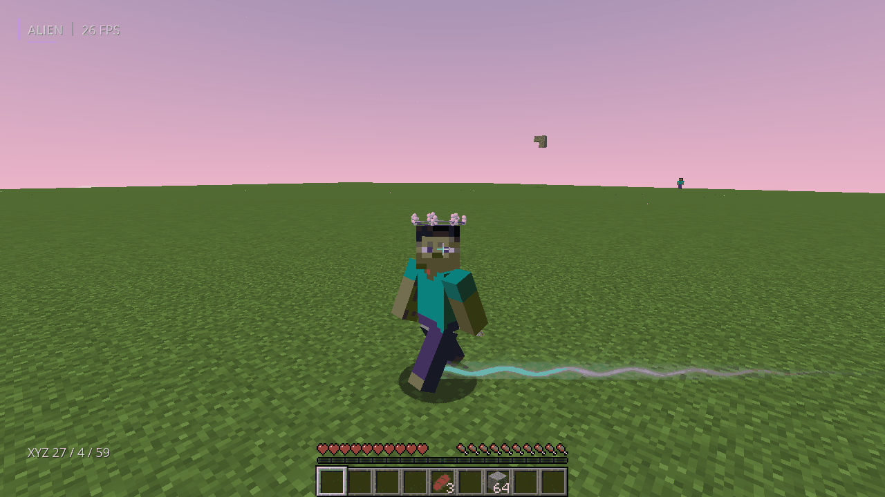
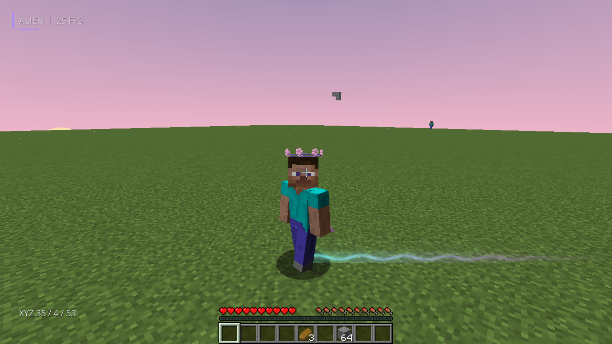
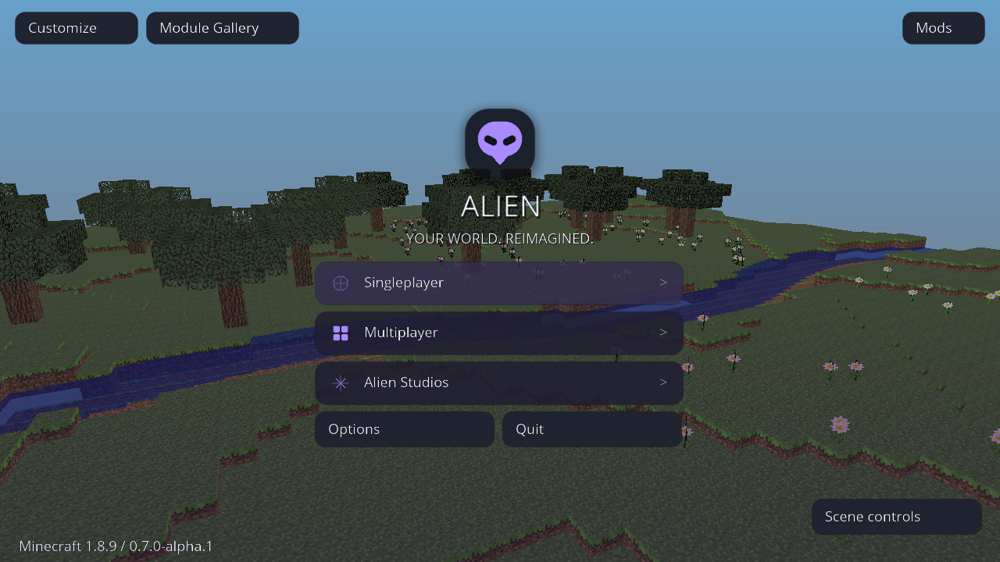
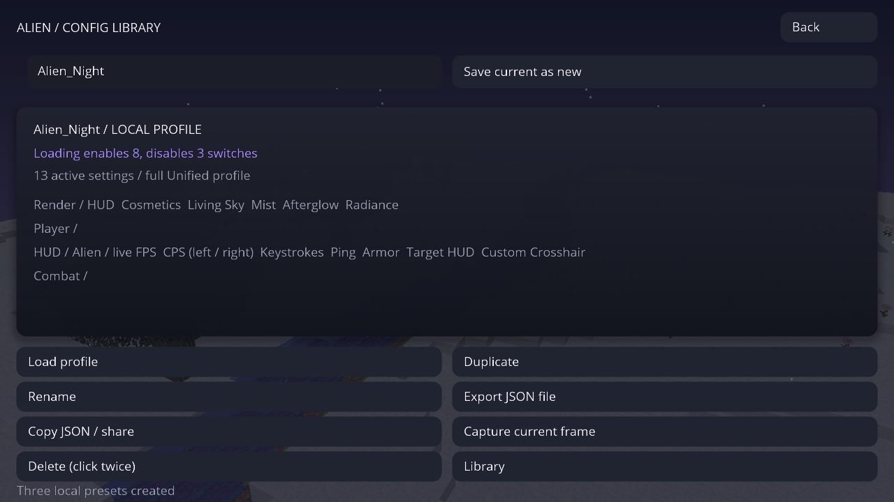
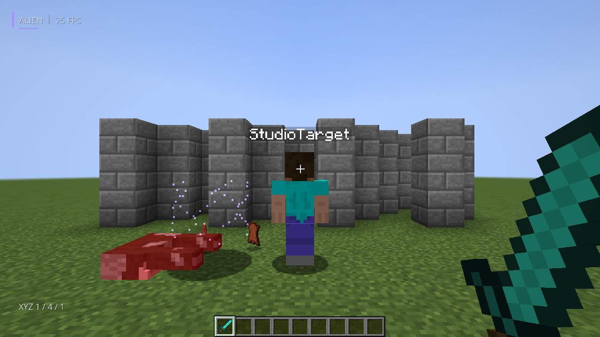

# Capturas atuais — Trail Studio / Unified 0.7.0-alpha.1

**190 PNGs novos e originais**, Minecraft Forge 1.8.9 / Java 8u472 / Linux Xorg dummy / Mesa, em 29/10/2026. Fonte `f10f753eae78e95fa8a76112f5a58b689d5063ae`, [CI aprovado 40887787750](https://github.com/AttackAlien/Alien-Client/actions/runs/40887787750). São 189 capturas do framebuffer e uma da janela X11; sem retoques, montagem ou geração de imagem.

**Todas as imagens anteriores da pasta atual foram substituídas.** Os GIFs foram refeitos com os frames novos: vinte para as trilhas, com intervalos registrados, e doze para a capa. Não houve nova gravação contínua longa nesta revisão.

**193 JUnit, 586 verificações gráficas e 12 testes de empacotamento aprovados.** As seis sessões foram: geral 161, céu 37, combate 24, HUD/Full/cosméticos/Trail Studio 152, Scene Studio 70 e Interactive Studio 142. Os checks incluem handlers, estados e capturas; não equivalem a 586 golden images ou benchmark.

[Como usar](../docs/TRAIL-STUDIO.md) · [Validação e limites](../docs/TRAIL-STUDIO-VALIDATION.md) · [JAR/ZIP](../downloads/v0.7.0-alpha.1/README.md) · [Launcher atualizado](launcher-atual/README.md) · [Proveniência](atual/unified/validation.json) · [PR #22](https://github.com/AttackAlien/Alien-Client/pull/22), sem merge.

## Trail Studio — editor real

[Curva de largura](atual/unified/130-trail-width-curve.png) · [Curva de transparência](atual/unified/131-trail-opacity-curve.png) · [HSV/HEX](atual/unified/132-trail-color-picker.png) · [PNG próprio](atual/unified/133-trail-png-material.png) · [Valor numérico](atual/unified/134-trail-exact-opacity.png) · [Layout compacto](atual/unified/139-trail-studio-compact.png).

## Trilha em movimento

GIF derivado somente dos vinte PNGs reais `trail-motion-*.png`, sem interpolação. Movimento lateral por teclado X11 e câmera ajustada pelo fixture.

## Presets no mundo

[Nebula](atual/unified/136-trail-nebula-world.png) · [Ember](atual/unified/137-trail-ember-world.png) · [Glacier](atual/unified/138-trail-glacier-world.png) · [PNG importado](atual/unified/135-trail-custom-png-world.png).

[Fallback real de PNG rejeitado](atual/unified/140-trail-invalid-png-fallback.png) · [OFF](atual/unified/142-trail-off-restored.png) · [Particles preservado](atual/unified/143-trail-particles-preserved.png). O PNG quadriculado da importação é uma entrada sintética de teste realmente renderizada no jogo; não é uma foto simulada. As máscaras prontas são originais do client.

Os logs completos estão no artifact; [ocorrências selecionadas](atual/unified/known-log-errors.txt) registram as limitações restantes do ambiente/fixtures. As imagens abaixo também foram atualizadas na mesma rodada.

| Recurso novo | Captura real |
| --- | --- |
| Janela real X11 | [Abrir PNG original](atual/unified/127-main-menu-actual-x11-window.png) |
| Menu 3D interativo | [Abrir PNG original](atual/unified/91-interactive-main-menu.png) |
| Cenário / hora / clima / câmera | [Abrir PNG original](atual/unified/92-menu-scene-controls.png) |
| Alpine à noite | [Abrir PNG original](atual/unified/93-alpine-menu-night.png) |
| Multiplayer com blur real | [Abrir PNG original](atual/unified/94-multiplayer-menu-blur.png) |
| Galeria de módulos e novos efeitos | [Abrir PNG original](atual/unified/125-gallery-scene-effects.png) |
| Módulos do jogador | [Abrir PNG original](atual/unified/96-module-gallery-player.png) |
| Widgets existentes na galeria | [Abrir PNG original](atual/unified/97-module-gallery-hud.png) |
| Biblioteca de perfis | [Abrir PNG original](atual/unified/98-profile-library.png) |
| Prévia das mudanças ao carregar | [Abrir PNG original](atual/unified/99-profile-load-preview.png) |
| Perfil carregado / foto real | [Abrir PNG original](atual/unified/100-profile-in-use.png) |
| Name Tags reais | [Abrir PNG original](atual/unified/101-live-name-tags.png) |
| Target ESP | [Abrir PNG original](atual/unified/102-target-esp-ring.png) |
| Parede bloqueia tags/Target ESP | [Abrir PNG original](atual/unified/126-occluded-target-hidden.png) |
| Mist | [Abrir PNG original](atual/unified/104-mist-world.png) |
| Bokeh | [Abrir PNG original](atual/unified/105-bokeh-depth-focus.png) |
| Radiance | [Abrir PNG original](atual/unified/106-radiance-world-hand.png) |
| Hand Movement / Zoom | [Abrir PNG original](atual/unified/107-hand-motion-zoom.png) |
| Afterglow em morte real | [Abrir PNG original](atual/unified/108-afterglow-real-death.png) |
| Galeria dos oito estilos de céu | [Abrir PNG original](atual/unified/119-living-sky-controls.png) |
| Configurações do jogador / profundidade | [Abrir PNG original](atual/unified/120-player-depth-settings.png) |
| Orbit | [Abrir PNG original](atual/unified/123-orbit-navigation.png) |

## Menu interativo

## Novos módulos

## Perfis e comparação antes de carregar

## Céus do vídeo e controles reais

[Galaxy](atual/unified/109-living-sky-galaxy.png) · [Aether](atual/unified/110-living-sky-aether.png) · [Nocturne](atual/unified/111-living-sky-nocturne.png) · [Amethyst](atual/unified/112-living-sky-amethyst.png) · [Opaline](atual/unified/113-living-sky-opaline.png) · [Rain](atual/unified/114-living-sky-rain.png) · [Snow](atual/unified/115-living-sky-snow.png) · [Fire](atual/unified/116-living-sky-fire.png).

## Afterglow

## Recursos anteriores preservados — capturas também atualizadas

## Scene Studio

[Controles reais](atual/unified/78-scene-studio-controls.png) · [Animação do céu em outro frame](atual/unified/90-cosmic-sky-animation.png) · [OFF restaurado](atual/unified/87-scene-fx-off-restored.png).

## Cyberspace

## Shockwave e Glass

## Céu BlackHole

## Trilha Ribbon e capa em movimento

[Abrir foto original](atual/unified/66-ribbon-trail-and-cape-moving.png) · [Controles](atual/unified/65-cosmetic-ribbon-controls.png) · [Capa após parar](atual/unified/68-cape-relaxed-after-motion.png)

## Novo headwear Sakura e kasa refinado

[Abrir Studio](atual/unified/70-sakura-cosmetic-studio.png) · [Coroa no mundo](atual/unified/63-sakura-wreath-world.png) · [Kasa](atual/unified/69-woven-kasa-world.png)

## Trama de tecido CC0 na capa

[Foto original](atual/unified/64-cc0-fabric-cape-studio.png) · [Fontes, autoria e licença](../docs/VISUAL-POLISH-REFERENCES.md)

## Partículas Cinematic — brilho e bordas suaves

[Abrir foto original](atual/unified/59-particles-cinematic-live.png)

## Sakura — pétalas refinadas

[Abrir foto original](atual/unified/60-particles-sakura-live.png)

## Particle Studio — controles funcionais

[Abrir foto original](atual/unified/62-particle-studio-controls.png) · [Preset PvP no mundo](atual/unified/61-particles-pvp-live.png)

## HUD Ultimate dentro do mundo

Alvo de treino client-side, skin vanilla real, HP da entidade, mira personalizada, teclas/input X11, CPS e armadura sincronizada pelo servidor integrado. O alvo não representa um jogador conectado a um servidor externo.

[Abrir foto](atual/unified/40-hud-ultimate-pvp-live.png) · [HP animando](atual/unified/41-target-health-animation.png) · [HP em 8/20](atual/unified/42-target-damaged.png)

## HUD Editor e presets

[Editor](atual/unified/43-hud-ultimate-editor.png) · [Presets e temas](atual/unified/44-hud-presets-themes.png) · [Survival](atual/unified/45-hud-survival-live.png) · [Cinematic](atual/unified/46-hud-cinematic-live.png) · [Crosshair](atual/unified/47-crosshair-options.png) · [Escala reduzida](atual/unified/53-hud-ultimate-scaled.png) · [Tema Light](atual/unified/57-hud-light-theme-live.png)

## Full no mesmo Unified

[Abrir foto](atual/unified/56-full-preset-enabled.png) · [Catálogo Combat](atual/unified/58-full-combat-catalog.png) · [Auto Food](atual/unified/48-auto-food-result.png) · [Poção de cura](atual/unified/49-auto-potion-result.png) · [Aimbot](atual/unified/50-aimbot-target-hud.png) · [Bridge no servidor integrado](atual/unified/51-auto-bridge-server-block.png) · [Poção splash](atual/unified/54-auto-splash-potion-result.png)

Anti Aim / spin gira a câmera real; não implementa fake angles/desync ou proteção contra acertos. Veja os [limites reais](../docs/HUD-ULTIMATE.md).

## Menu inicial

[Abrir foto](atual/unified/01-title.png)

## Menu de módulos dentro do mundo

[Abrir foto](atual/unified/09c-alien-menu-inside-world.png)

## Cosméticos 3D

[Editor](atual/unified/26-cosmetic-studio-4x3-scaled.png) · [Looks](atual/unified/30-cosmetic-looks-gallery.png) · [Capa e emblema](atual/unified/15-cloth-cape-emblem-back.png) · [Asas](atual/unified/17-sculpted-wings-back-view.png) · [Kasa](atual/unified/14-smooth-kasa-and-cloth-front.png) · [Capa em movimento](atual/unified/capa-em-movimento.gif)

O GIF usa somente os 12 frames originais `cape-motion-*.png` desta sessão, sem interpolação de imagens.

## Céu e clima

[World Studio](atual/unified/09d-world-studio-inside-world.png) · [Crystal e HUD](atual/unified/18-crystal-cyan-sky-particles-hud.png) · [Sakura e HUD](atual/unified/19-sakura-petals-sky-hud.png) · [Vanilla restaurado](atual/unified/20-vanilla-sky-restored-after-presets.png) · [Testes de cubemap](atual/unified/sky/)

As fotos `sky/sky-cube-*` registram o jogo renderizando um atlas técnico de teste para validar orientação/cor das faces; não são um pacote artístico de céu.

## Outros controles preservados

| Tela | Captura atual |
| --- | --- |
| Performance Engine V2 | [Dashboard](atual/unified/32-performance-engine-dashboard.png) |
| Temas e cores | [Theme Studio](atual/unified/21-theme-editor-colors.png) · [Color Picker](atual/unified/28-color-picker-hsv-rgba.png) |
| Perfis Unified | [Config e perfis](atual/unified/29-config-profiles.png) |
| Atalhos por módulo | [Keybinds](atual/unified/27-module-settings-keybind.png) |
| Skybox Gallery | [Galeria](atual/unified/37-sky-gallery-minimal-white.png) |
| Combate anterior | [Regressão de mira/clique](atual/unified/combat/) |

[Resultado geral](atual/unified/result.txt) · [HUD/Full/cosméticos](atual/unified/result-ultimate.txt) · [Céu](atual/unified/result-sky.txt) · [Combate](atual/unified/result-combat.txt) · [Proveniência](atual/unified/validation.json) · [SHA-256](atual/unified/SHA256SUMS.txt)

[Scene Studio — 70 checks](atual/unified/result-scene.txt)
