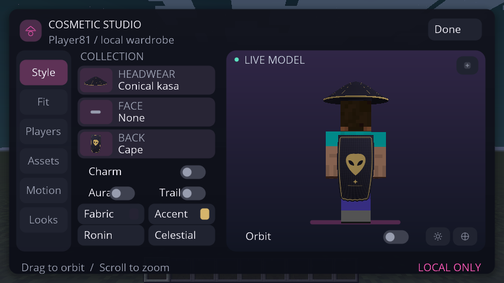
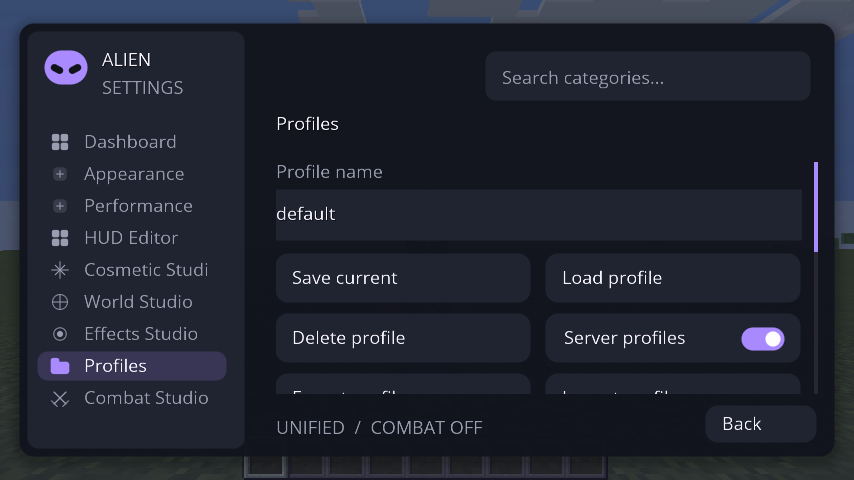

# Capturas atuais — Alien Client Unified

Capturadas em **23/10/2026** executando Minecraft 1.8.9 / Forge 11.15.1.2318 / Java 8 / Mesa / Xvfb. Código-base `933f93ef3498f204ee3858c78785fd4b7992d937`. **161 verificações gráficas passaram** nesta sessão. Sem ilustrações, IA ou retoques.

As imagens anteriores foram removidas desta galeria. Esta primeira sessão registra a base atual antes de HUD Ultimate e novos módulos Full; esses recursos ainda estão em desenvolvimento nesta branch.

## Menu inicial

[Abrir imagem](atual/unified/01-title.png)

## Menu de módulos dentro do mundo

[Abrir imagem](atual/unified/09c-alien-menu-inside-world.png)

## Cosmetic Studio 3D

[Abrir imagem](atual/unified/26-cosmetic-studio-4x3-scaled.png)

## Looks salvos

[Abrir imagem](atual/unified/30-cosmetic-looks-gallery.png)

## Capa com emblema

[Abrir imagem](atual/unified/15-cloth-cape-emblem-back.png)

## Céu e clima

[Abrir imagem](atual/unified/09d-world-studio-inside-world.png)

## HUD funcionando com partículas

[Abrir imagem](atual/unified/18-crystal-cyan-sky-particles-hud.png)

## HUD Editor atual

[Abrir imagem](atual/unified/24-hud-editor-16x10.png)

## Combat Studio atual

[Abrir imagem](atual/unified/33-unified-combat-studio.png)

## Performance Engine 2.0

[Abrir imagem](atual/unified/32-performance-engine-dashboard.png)

## Temas e cores

[Abrir imagem](atual/unified/21-theme-editor-colors.png)

## Perfis

[Abrir imagem](atual/unified/29-config-profiles.png)

[Todos os PNGs](atual/unified/) · [Resultado real](atual/unified/result.txt) · [SHA-256](atual/unified/SHA256SUMS.txt) · [Capa em movimento](atual/unified/capa-em-movimento.gif)
