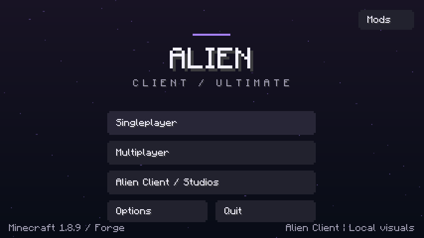
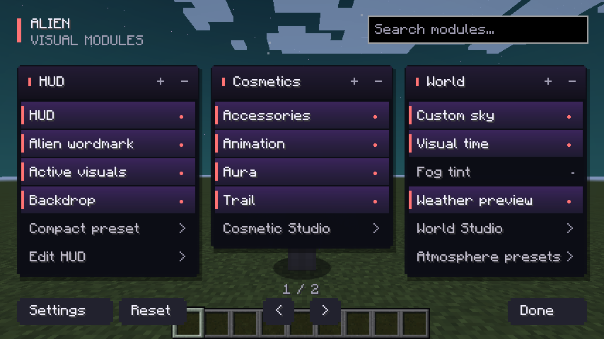
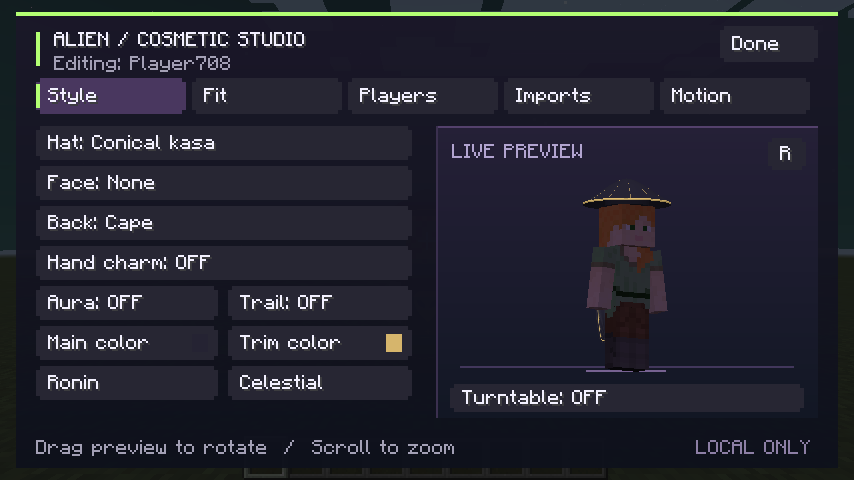
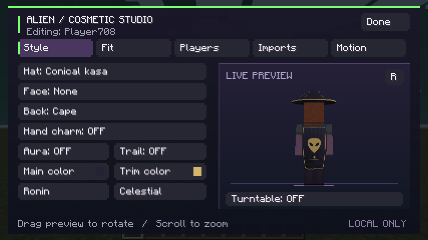
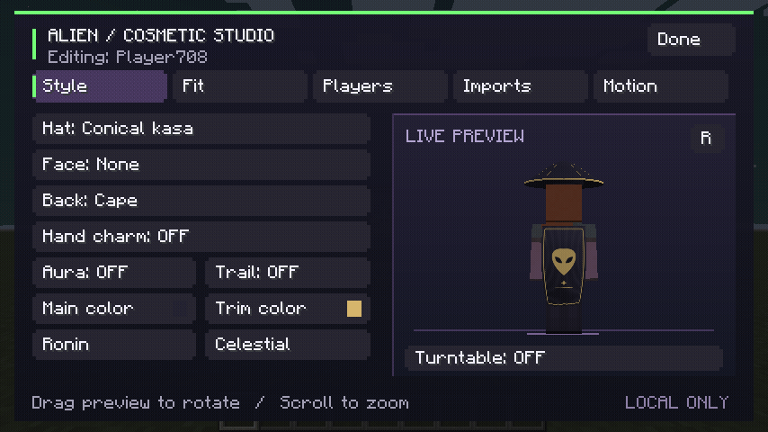
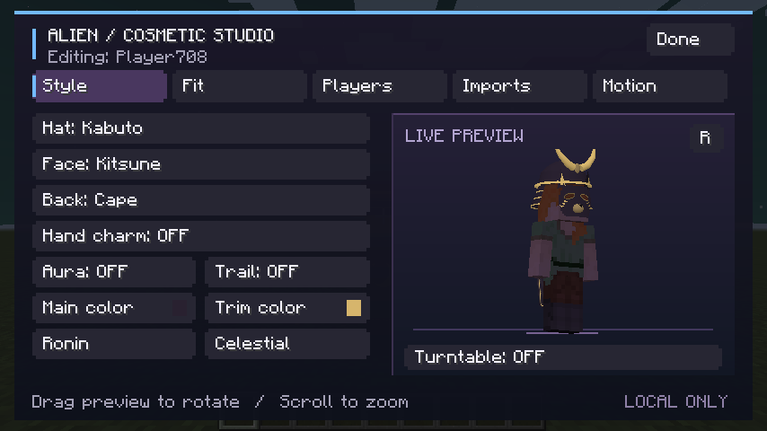
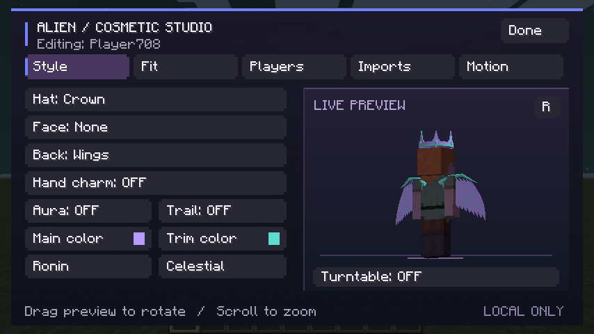
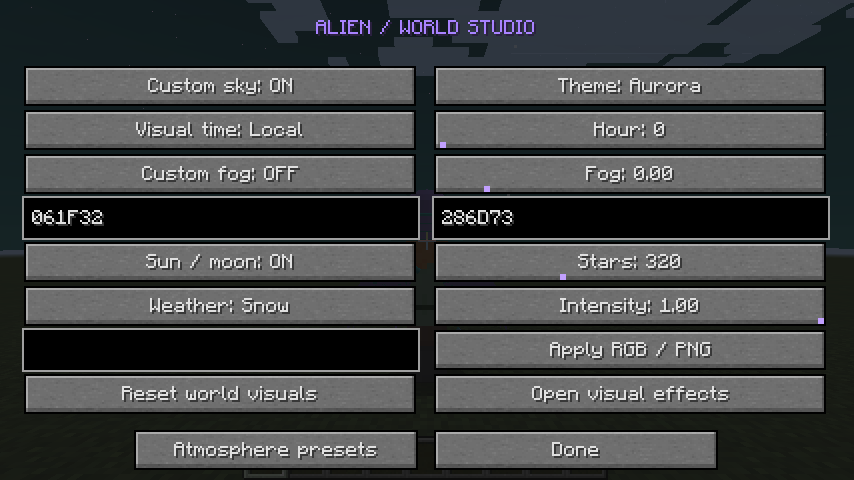
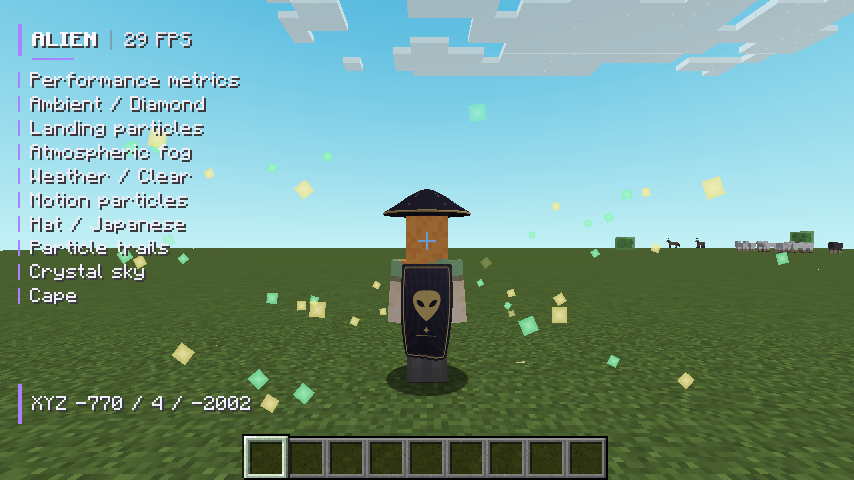
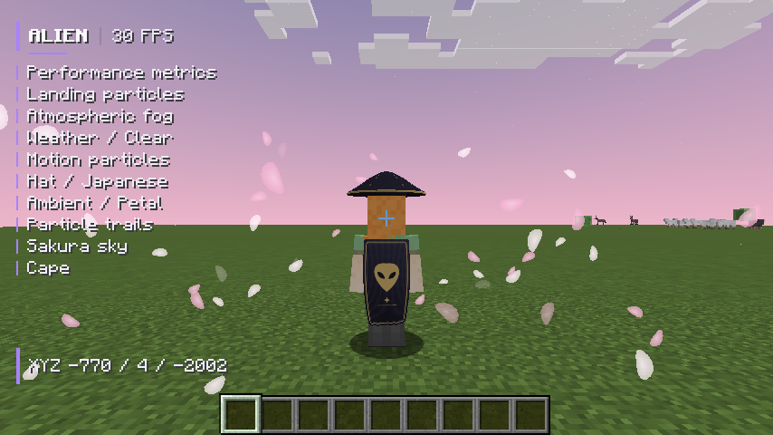

# Alien Client 0.2.0 — imagens reais

Estas imagens vieram do framebuffer do **Minecraft Java 1.8.9 / Forge 11.15.1.2318**, executado em 21/10/2026 com Java 8, Xvfb e OpenGL por software. Sem imagens ilustrativas, geração por IA ou retoques. A navegação foi automatizada nos controles reais; o mundo local é descartável.

**76 testes JUnit e 88 verificações gráficas passaram.** Foram obtidos 35 PNGs. O jogo estava limitado a 30 FPS; os números do HUD não são benchmark. [Relatório e comandos](../docs/VALIDATION.md) · [Resultado original](v0.2.0/result.txt) · [Todos os arquivos](v0.2.0/) · [Galeria anterior 0.1.0](https://github.com/AttackAlien/Alien-Client/blob/v0.1.0/captures/README.md).

Se a imagem não carregar no celular, toque no link **Abrir imagem**. O repositório é privado: abra com sua conta do GitHub autenticada.

## 1. Menu inicial

[Abrir imagem](v0.2.0/01-title.png)

## 2. Painéis de módulos dentro do mundo

Painéis arrastáveis, busca, rolagem individual e páginas em resoluções menores. Settings mantém o acesso ao menu Studio.

[Abrir imagem](v0.2.0/09c-alien-menu-inside-world.png)

## 3. Cosmetic Studio — chapéu curvo e capa

Chapéu kasa circular, capa de tecido com emblema original e prévia com rotação/zoom. O personagem continua com a geometria original do Minecraft.

[Abrir imagem de frente](v0.2.0/14-smooth-kasa-and-cloth-front.png) · [Abrir imagem da capa](v0.2.0/15-cloth-cape-emblem-back.png)

### Capa em movimento

GIF formado por **12 quadros originais do jogo**, capturados com intervalo mínimo de 100 ms e reproduzidos a 8 quadros/s. Sem interpolação. A comparação restrita à região do tecido encontrou até 132 pixels alterados entre os quadros. [Métrica original](v0.2.0/cape-motion-metrics.txt).

[Abrir animação](v0.2.0/capa-em-movimento.gif)

### Kabuto, máscara e asas

[Abrir Kabuto/Kitsune](v0.2.0/16-sculpted-samurai-kitsune.png) · [Abrir asas](v0.2.0/17-sculpted-wings-back-view.png)

## 4. Personalização de céu e clima

[Abrir editor](v0.2.0/09d-world-studio-inside-world.png)

## 5. HUD, céu e partículas funcionando

Crystal: céu cyan, diamantes mint/dourados, FPS real e lista de recursos visuais ativos. Sakura: céu rosa e pétalas. Os efeitos são locais e preservam o horário/clima reais do servidor.

[Abrir Crystal](v0.2.0/18-crystal-cyan-sky-particles-hud.png) · [Abrir Sakura](v0.2.0/19-sakura-petals-sky-hud.png) · [Abrir céu vanilla restaurado](v0.2.0/20-vanilla-sky-restored-after-presets.png)

## Limites

A capa usa deformação por ondas, sem colisões físicas; as partículas são formas planas voltadas para a câmera. Importação externa de modelos permanece em caixas JSON. Multiplayer público, launcher externo, OptiFine e GPUs reais não foram validados. [Escopo e funcionalidades pendentes](../docs/FEATURES.md).
