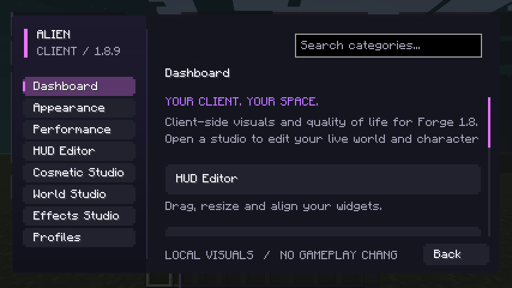
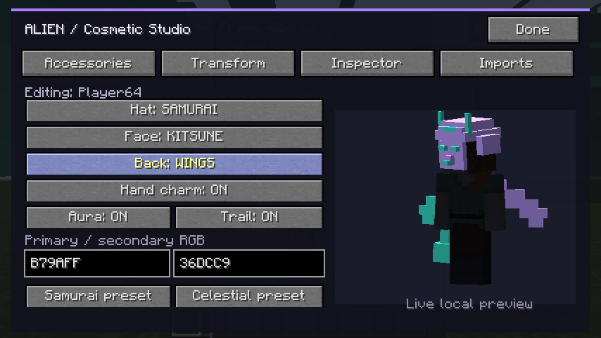
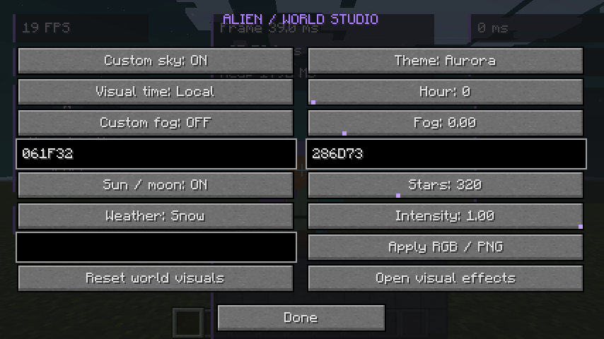
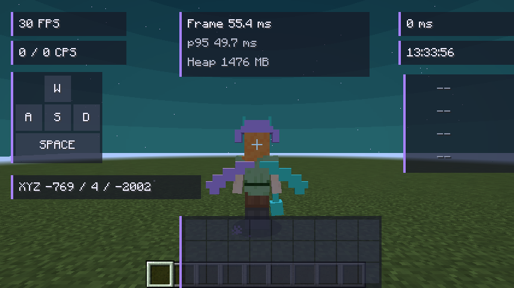

# Alien Client — capturas reais do Minecraft Forge 1.8.9

Capturas originais obtidas executando Minecraft 1.8.9 / Forge 11.15.1.2318 com Java 8, Xvfb e OpenGL por software. Os PNGs vieram do framebuffer do jogo, sem geração por IA ou retoques. Sessão funcional, com limite de 30 FPS; não é benchmark.

## Menu inicial


## Menu de módulos dentro do mundo



## Editor de cosméticos 3D



## Editor de céu e clima



## HUD dentro do mundo



## Validação

54 verificações gráficas e 46 testes JUnit passaram. O teste gráfico usa as classes atuais de desenvolvimento; instalação do JAR em launcher externo, OptiFine, multiplayer público, áudio e comparativos de desempenho ainda não foram validados. A navegação é automatizada nos controles reais.

## Execução

```bash
cd /workspace/Alien-Client
env -u DISPLAY ALIEN_TOOLS_DIR=/workspace/.alien-tools ./scripts/smoke-client.sh
ALIEN_TOOLS_DIR=/workspace/.alien-tools ./gradlew --no-daemon cleanTest test
```
