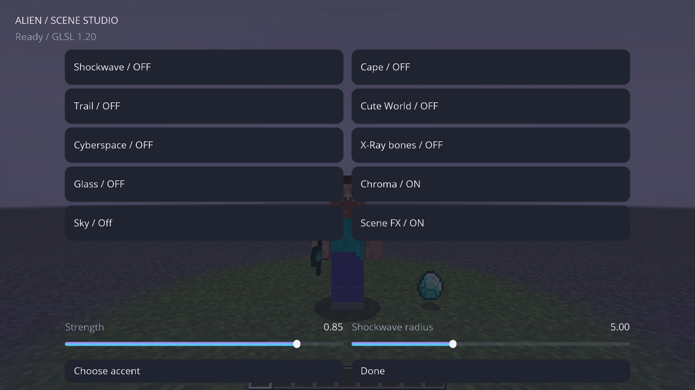
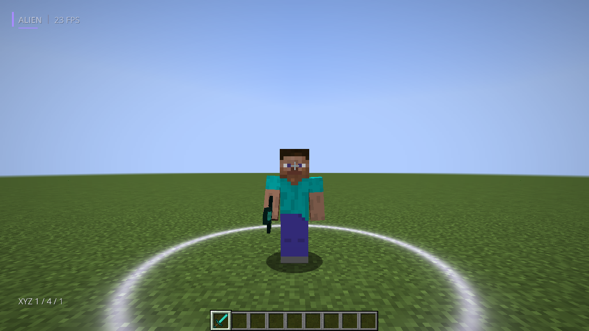
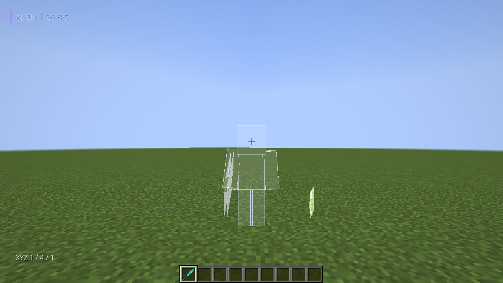
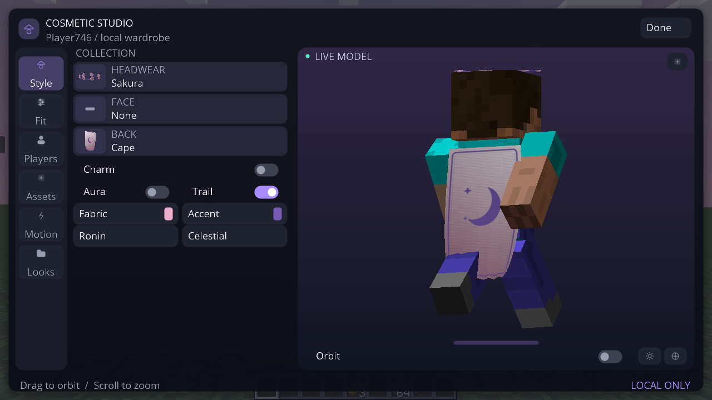

# Capturas atuais — Alien Scene Studio 0.5.0-alpha.1

**117 PNGs originais**, executando **Minecraft Forge 1.8.9**, em **24/10/2026**, 16:53–16:57 UTC. Fonte `3a8ee39413c8309168a13ee3a6295e0b4b68e3b6`; Linux/Xvfb/Mesa, Java 8. São capturas reais do framebuffer, sem montagens ou IA.

Foram identificados e implementados os **nove recursos do vídeo indicado**, em variantes originais Alien. A versão do jogo foi mantida; 0.5.0-alpha.1 é a versão do client. [Recursos e limites](../docs/VISUAL-SCENES.md) · [Resultados/comandos](../docs/VISUAL-SCENES-VALIDATION.md) · [PR #17](https://github.com/AttackAlien/Alien-Client/pull/17).

As mídias anteriores foram substituídas. Cinco sessões desta revisão passaram **384 verificações gráficas**: 161 gerais, 37 céu, 24 combate, 92 HUD/Full/cosméticos e 70 Scene Studio. Os números incluem verificações de captura, não são um benchmark.

**[Vídeo completo — 3min48s / GIF — 2min15s](video-atual/README.md)** · [JAR/ZIP de teste](../downloads/v0.5.0-alpha.1/) · [Todos os PNGs](atual/unified/)

| Recurso | Captura real |
| --- | --- |
| Shockwave ao pousar | [Onda no terreno](atual/unified/72-shockwave-landing.png) |
| Capa animada | [Capa em movimento](atual/unified/66-ribbon-trail-and-cape-moving.png) · [Tecido e emblema](atual/unified/64-cc0-fabric-cape-studio.png) |
| Trail | [Fita luminosa](atual/unified/66-ribbon-trail-and-cape-moving.png) |
| Cute World | [Olhos, bochechas e sorriso](atual/unified/73-cute-world.png) |
| Cyberspace | [Grade de mundo e céu](atual/unified/74-cyberspace-world.png) |
| X-Ray de ossos | [Esqueleto com poses reais](atual/unified/75-xray-skeleton.png) |
| Glass | [Jogador, espada e item solto](atual/unified/76-glass-player-items.png) |
| Chroma | [Mundo com cores locais](atual/unified/77-chroma-world.png) · [Caminho em movimento](atual/unified/88-chroma-moving-path.png) |
| Oito céus animados | [BlackHole](atual/unified/79-blackhole-sky.png) · [Cosmic](atual/unified/80-cosmic-sky.png) · [Aurora](atual/unified/81-aurora-living-sky.png) · [SnowClouds](atual/unified/82-snow-clouds-sky.png) · [Fire](atual/unified/83-fire-sky.png) · [Sunset](atual/unified/84-sunset-sky.png) · [Ocean](atual/unified/85-ocean-sky.png) · [Storm](atual/unified/86-storm-sky.png) |

## Scene Studio

[Controles reais](atual/unified/78-scene-studio-controls.png) · [Animação do céu em outro frame](atual/unified/90-cosmic-sky-animation.png) · [OFF restaurado](atual/unified/87-scene-fx-off-restored.png).

## Cyberspace

## Shockwave e Glass

## Céu BlackHole

## Trilha Ribbon e capa em movimento

[Abrir foto original](atual/unified/66-ribbon-trail-and-cape-moving.png) · [Controles](atual/unified/65-cosmetic-ribbon-controls.png) · [Capa após parar](atual/unified/68-cape-relaxed-after-motion.png)

## Novo headwear Sakura e kasa refinado

[Abrir Studio](atual/unified/70-sakura-cosmetic-studio.png) · [Coroa no mundo](atual/unified/63-sakura-wreath-world.png) · [Kasa](atual/unified/69-woven-kasa-world.png)

## Trama de tecido CC0 na capa

[Foto original](atual/unified/64-cc0-fabric-cape-studio.png) · [Fontes, autoria e licença](../docs/VISUAL-POLISH-REFERENCES.md)

## Partículas Cinematic — brilho e bordas suaves

[Abrir foto original](atual/unified/59-particles-cinematic-live.png)

## Sakura — pétalas refinadas

[Abrir foto original](atual/unified/60-particles-sakura-live.png)

## Particle Studio — controles funcionais

[Abrir foto original](atual/unified/62-particle-studio-controls.png) · [Preset PvP no mundo](atual/unified/61-particles-pvp-live.png)

## HUD Ultimate dentro do mundo

Alvo de treino client-side, skin vanilla real, HP da entidade, mira personalizada, teclas/input X11, CPS e armadura sincronizada pelo servidor integrado. O alvo não representa um jogador conectado a um servidor externo.

[Abrir foto](atual/unified/40-hud-ultimate-pvp-live.png) · [HP animando](atual/unified/41-target-health-animation.png) · [HP em 8/20](atual/unified/42-target-damaged.png)

## HUD Editor e presets

[Editor](atual/unified/43-hud-ultimate-editor.png) · [Presets e temas](atual/unified/44-hud-presets-themes.png) · [Survival](atual/unified/45-hud-survival-live.png) · [Cinematic](atual/unified/46-hud-cinematic-live.png) · [Crosshair](atual/unified/47-crosshair-options.png) · [Escala reduzida](atual/unified/53-hud-ultimate-scaled.png) · [Tema Light](atual/unified/57-hud-light-theme-live.png)

## Full no mesmo Unified

[Abrir foto](atual/unified/56-full-preset-enabled.png) · [Catálogo Combat](atual/unified/58-full-combat-catalog.png) · [Auto Food](atual/unified/48-auto-food-result.png) · [Poção de cura](atual/unified/49-auto-potion-result.png) · [Aimbot](atual/unified/50-aimbot-target-hud.png) · [Bridge no servidor integrado](atual/unified/51-auto-bridge-server-block.png) · [Poção splash](atual/unified/54-auto-splash-potion-result.png)

Anti Aim / spin gira a câmera real; não implementa fake angles/desync ou proteção contra acertos. Veja os [limites reais](../docs/HUD-ULTIMATE.md).

## Menu inicial

[Abrir foto](atual/unified/01-title.png)

## Menu de módulos dentro do mundo

[Abrir foto](atual/unified/09c-alien-menu-inside-world.png)

## Cosméticos 3D

[Editor](atual/unified/26-cosmetic-studio-4x3-scaled.png) · [Looks](atual/unified/30-cosmetic-looks-gallery.png) · [Capa e emblema](atual/unified/15-cloth-cape-emblem-back.png) · [Asas](atual/unified/17-sculpted-wings-back-view.png) · [Kasa](atual/unified/14-smooth-kasa-and-cloth-front.png) · [Capa em movimento](atual/unified/capa-em-movimento.gif)

O GIF usa somente os 12 frames originais `cape-motion-*.png` desta sessão, sem interpolação de imagens.

## Céu e clima

[World Studio](atual/unified/09d-world-studio-inside-world.png) · [Crystal e HUD](atual/unified/18-crystal-cyan-sky-particles-hud.png) · [Sakura e HUD](atual/unified/19-sakura-petals-sky-hud.png) · [Vanilla restaurado](atual/unified/20-vanilla-sky-restored-after-presets.png) · [Testes de cubemap](atual/unified/sky/)

As fotos `sky/sky-cube-*` registram o jogo renderizando um atlas técnico de teste para validar orientação/cor das faces; não são um pacote artístico de céu.

## Outros controles preservados

| Tela | Captura atual |
| --- | --- |
| Performance Engine V2 | [Dashboard](atual/unified/32-performance-engine-dashboard.png) |
| Temas e cores | [Theme Studio](atual/unified/21-theme-editor-colors.png) · [Color Picker](atual/unified/28-color-picker-hsv-rgba.png) |
| Perfis Unified | [Config e perfis](atual/unified/29-config-profiles.png) |
| Atalhos por módulo | [Keybinds](atual/unified/27-module-settings-keybind.png) |
| Skybox Gallery | [Galeria](atual/unified/37-sky-gallery-minimal-white.png) |
| Combate anterior | [Regressão de mira/clique](atual/unified/combat/) |

[Resultado geral](atual/unified/result.txt) · [HUD/Full/cosméticos](atual/unified/result-ultimate.txt) · [Céu](atual/unified/result-sky.txt) · [Combate](atual/unified/result-combat.txt) · [Proveniência](atual/unified/validation.json) · [SHA-256](atual/unified/SHA256SUMS.txt)

[Scene Studio — 70 checks](atual/unified/result-scene.txt)
