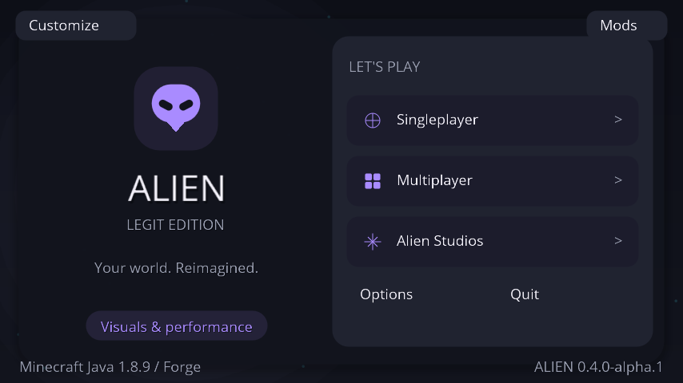
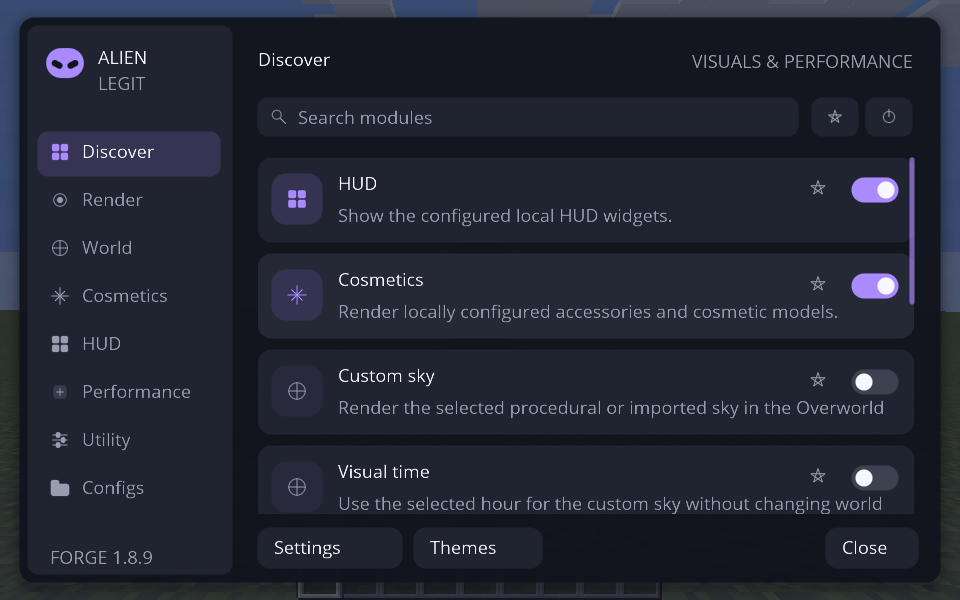
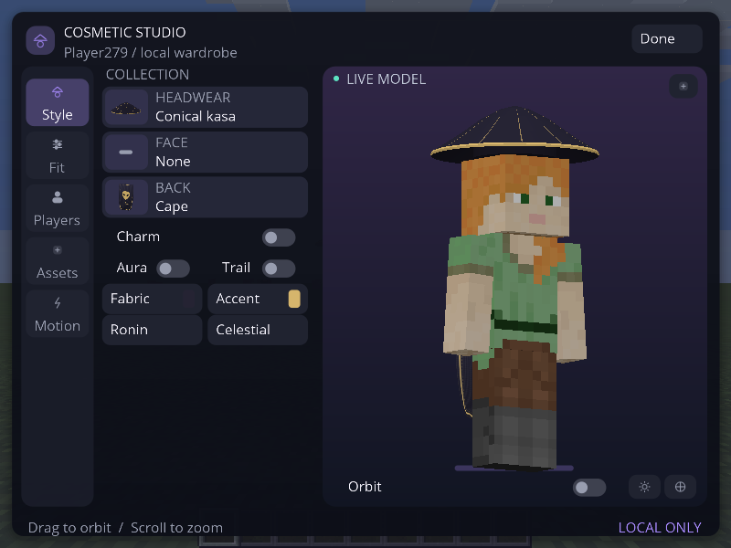
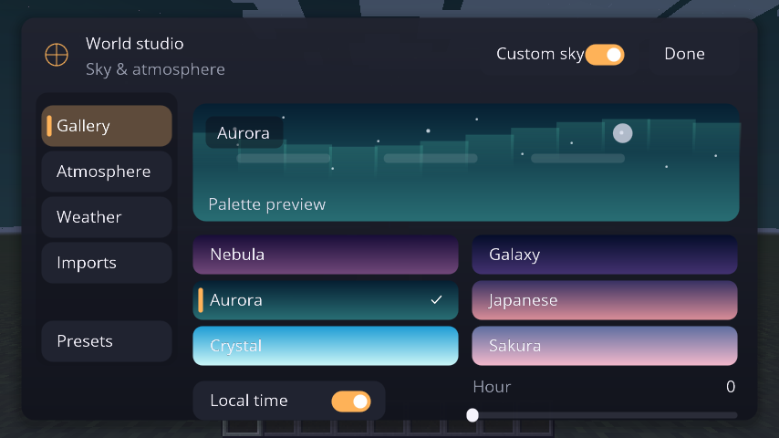
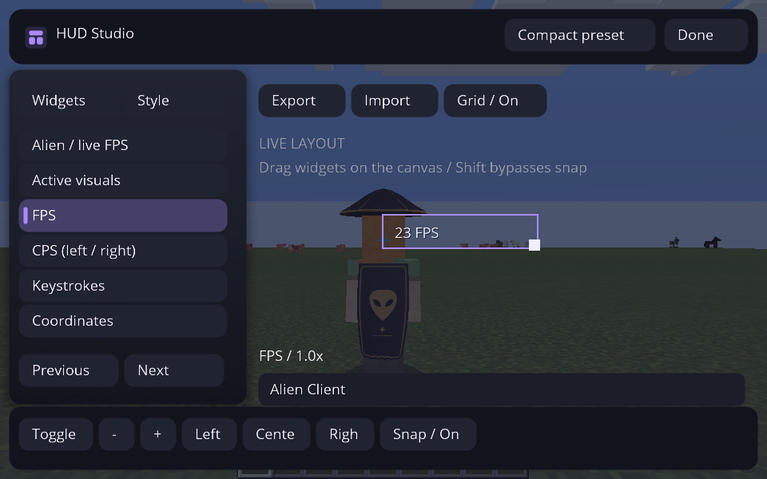
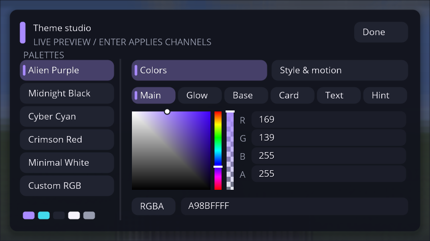
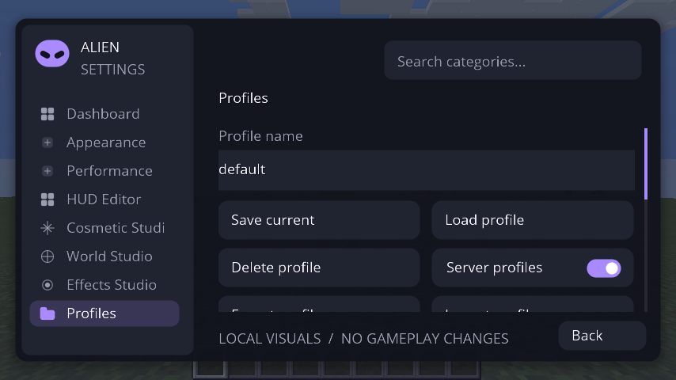
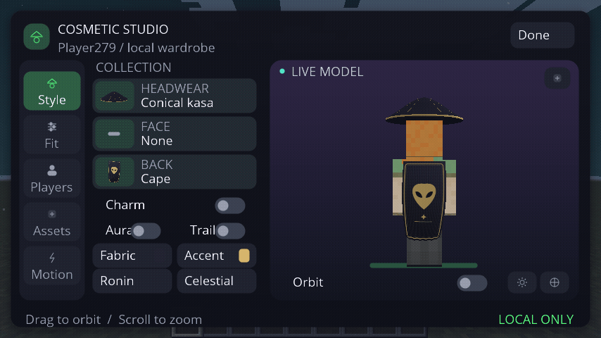

> **Prévia do redesign 0.4:** estas capturas e binários pertencem ao código testado na branch [ui-overhaul-20261022](https://github.com/AttackAlien/Alien-Client/tree/ui-overhaul-20261022). A integração com o Unified/Sky Studio Ultimate mais recente está no [PR #8](https://github.com/AttackAlien/Alien-Client/pull/8); o código atual da main foi preservado.

# Imagens novas — redesign Alien Client 0.4

**Todas as imagens abaixo são capturas reais do Minecraft Java 1.8.9 / Forge 11.15.1.2318.** Não foram usados mockups, imagens ilustrativas, geração por IA ou retoques.

As imagens antigas foram removidas da versão atual do repositório. Esta galeria mostra somente o redesign: menus próprios, Open Sans suavizada, cartões arredondados, sombras, nova navegação, estúdios e temas.

**101 testes JUnit e 124 verificações gráficas passaram em cada edição**, com 44 PNGs por execução. [Resultado Legit](atual/legit/result.txt) · [Resultado Full](atual/full/result.txt) · [Relatório e comandos](../docs/UI-OVERHAUL-VALIDATION.md).

Toque em **Abrir imagem** para ver o arquivo inteiro no celular. O repositório é público; não é necessário entrar na conta.

## Menu inicial

[Abrir imagem](atual/legit/01-title.png)

## ClickGUI — categorias, pesquisa e módulos

[Abrir imagem](atual/legit/23-clickgui-16x10.png) · [Detalhes e editor de atalhos](atual/legit/27-module-settings-keybind.png)

## Cosmetic Studio

[Abrir imagem](atual/legit/26-cosmetic-studio-4x3-scaled.png) · [Ver capa por trás](atual/legit/15-cloth-cape-emblem-back.png) · [Kabuto/Kitsune](atual/legit/16-sculpted-samurai-kitsune.png)

## World Studio — céu e atmosfera

[Abrir imagem](atual/legit/09d-world-studio-inside-world.png)

## HUD Studio

[Abrir imagem](atual/legit/24-hud-editor-16x10.png) · [HUD funcionando sem o editor](atual/legit/18-crystal-cyan-sky-particles-hud.png)

## Theme Studio — HSV, RGBA e HEX

[Abrir imagem](atual/legit/21-theme-editor-colors.png) · [Estilo, escala, movimento e blur](atual/legit/22-theme-style-motion-blur.png) · [Seletor de cores](atual/legit/28-color-picker-hsv-rgba.png)

## Configurações e perfis

[Abrir imagem](atual/legit/29-config-profiles.png) · [Aparência](atual/legit/03-appearance.png) · [Efeitos](atual/legit/07-effects-studio.png)

## Edição Full

A Full mantém os recursos visuais compartilhados e continua sendo uma prévia de arquitetura, sem módulos avançados implementados.

[Abrir menu Full](atual/full/01-title.png) · [Abrir ClickGUI Full](atual/full/23-clickgui-16x10.png) · [Abrir editor 3D Full](atual/full/26-cosmetic-studio-4x3-scaled.png)

## Capa em movimento

GIF composto por 12 quadros originais do jogo, capturados com intervalo mínimo de 100 ms e reproduzidos a 8 quadros/s, sem interpolação.

[Abrir animação](atual/legit/capa-em-movimento.gif)

[Todos os PNGs Legit](atual/legit/) · [Todos os PNGs Full](atual/full/).

A rodada incluiu 854×480, 960×600 e 800×600, além de escala de menu 0,85. Foi usado Java 8, Xvfb e OpenGL por software, com limite de 30 FPS. Não é benchmark; a instalação em launcher externo, OptiFine, áudio e multiplayer não foi validada. Os detalhes/limites estão no relatório.
