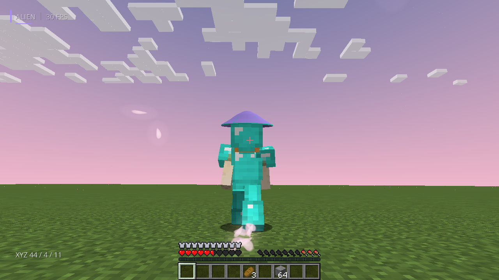
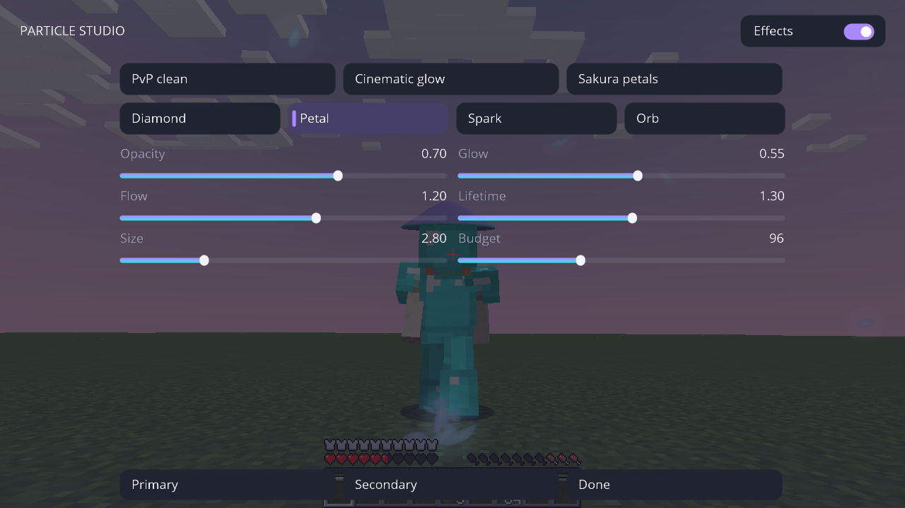
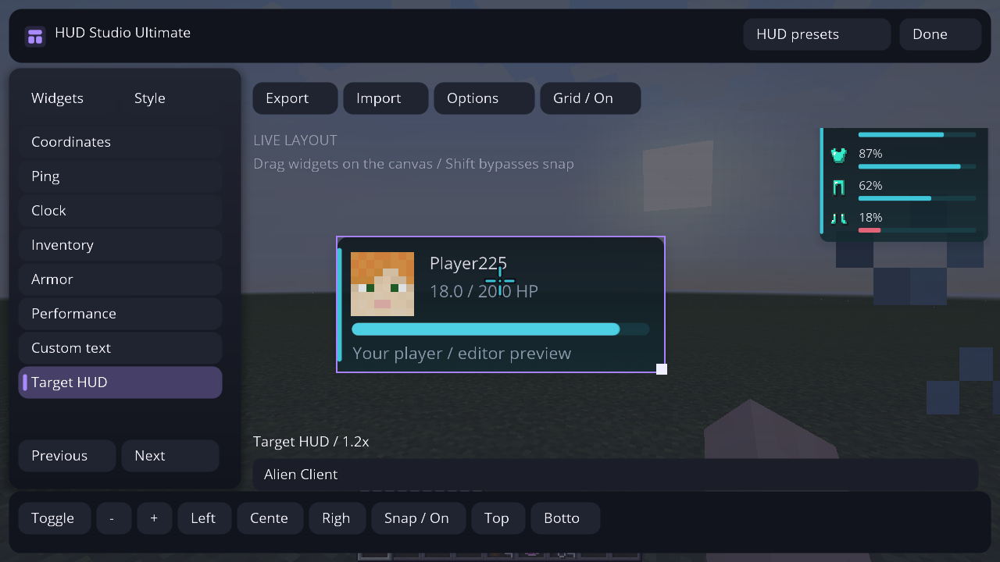
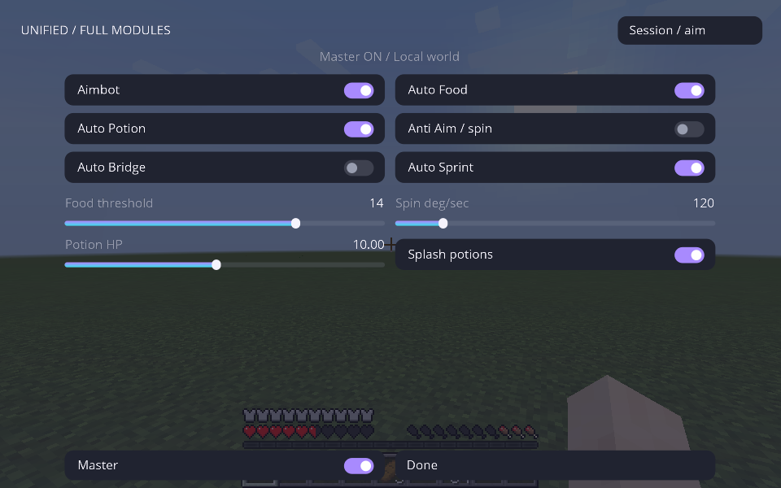
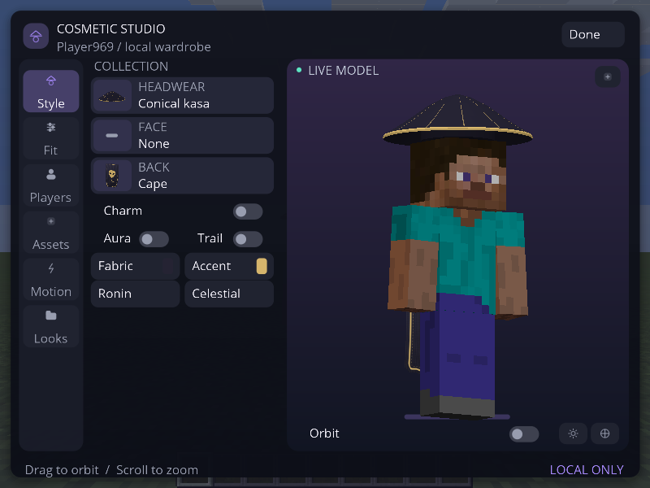

# Capturas atuais — Unified 0.4.0-alpha.3

**89 PNGs originais**, capturados em **23/10/2026**, entre 14:38 e 14:41 UTC, executando Minecraft Java 1.8.9 / Forge 11.15.1.2318 / Java 8 / Linux, Mesa e Xvfb. Código: `18c84442ffab1cdbd84d70bec3d7b9e50c2c56ea`; revisão gravada: `f25304750ac8d73d4c01d5ccf1d213c6083f0b59`. Sem imagens por IA, montagens ou retoques.

As fotos anteriores foram substituídas nesta galeria. Quatro sessões novas da mesma revisão: **161 verificações gerais, 73 HUD/Full/partículas, 37 céu e 24 combate**, todas aprovadas. Os números incluem verificações de captura do framebuffer. Não são um benchmark de FPS.

**[Vídeo completo — 3min02s e GIF — 1min03s](video-atual/README.md)**

[Todos os PNGs](atual/unified/) · [Testes e comandos](../docs/HUD-ULTIMATE-VALIDATION.md) · [PR #15](https://github.com/AttackAlien/Alien-Client/pull/15) · [JAR de teste](../downloads/v0.4.0-alpha.3/)

## Partículas Cinematic — brilho e bordas suaves

[Abrir foto original](atual/unified/59-particles-cinematic-live.png)

## Sakura — pétalas refinadas

[Abrir foto original](atual/unified/60-particles-sakura-live.png)

## Particle Studio — controles funcionais

[Abrir foto original](atual/unified/62-particle-studio-controls.png) · [Preset PvP no mundo](atual/unified/61-particles-pvp-live.png)

## HUD Ultimate dentro do mundo

Alvo de treino client-side, skin vanilla real, HP da entidade, mira personalizada, teclas/input X11, CPS e armadura sincronizada pelo servidor integrado. O alvo não representa um jogador conectado a um servidor externo.

[Abrir foto](atual/unified/40-hud-ultimate-pvp-live.png) · [HP animando](atual/unified/41-target-health-animation.png) · [HP em 8/20](atual/unified/42-target-damaged.png)

## HUD Editor e presets

[Editor](atual/unified/43-hud-ultimate-editor.png) · [Presets e temas](atual/unified/44-hud-presets-themes.png) · [Survival](atual/unified/45-hud-survival-live.png) · [Cinematic](atual/unified/46-hud-cinematic-live.png) · [Crosshair](atual/unified/47-crosshair-options.png) · [Escala reduzida](atual/unified/53-hud-ultimate-scaled.png) · [Tema Light](atual/unified/57-hud-light-theme-live.png)

## Full no mesmo Unified

[Abrir foto](atual/unified/56-full-preset-enabled.png) · [Catálogo Combat](atual/unified/58-full-combat-catalog.png) · [Auto Food](atual/unified/48-auto-food-result.png) · [Poção de cura](atual/unified/49-auto-potion-result.png) · [Aimbot](atual/unified/50-aimbot-target-hud.png) · [Bridge no servidor integrado](atual/unified/51-auto-bridge-server-block.png) · [Poção splash](atual/unified/54-auto-splash-potion-result.png)

Anti Aim / spin gira a câmera real; não implementa fake angles/desync ou proteção contra acertos. Veja os [limites reais](../docs/HUD-ULTIMATE.md).

## Menu inicial

[Abrir foto](atual/unified/01-title.png)

## Menu de módulos dentro do mundo

[Abrir foto](atual/unified/09c-alien-menu-inside-world.png)

## Cosméticos 3D

[Editor](atual/unified/26-cosmetic-studio-4x3-scaled.png) · [Looks](atual/unified/30-cosmetic-looks-gallery.png) · [Capa e emblema](atual/unified/15-cloth-cape-emblem-back.png) · [Asas](atual/unified/17-sculpted-wings-back-view.png) · [Kasa](atual/unified/14-smooth-kasa-and-cloth-front.png) · [Capa em movimento](atual/unified/capa-em-movimento.gif)

O GIF usa somente os 12 frames originais `cape-motion-*.png` desta sessão, sem interpolação de imagens.

## Céu e clima

[World Studio](atual/unified/09d-world-studio-inside-world.png) · [Crystal e HUD](atual/unified/18-crystal-cyan-sky-particles-hud.png) · [Sakura e HUD](atual/unified/19-sakura-petals-sky-hud.png) · [Vanilla restaurado](atual/unified/20-vanilla-sky-restored-after-presets.png) · [Testes de cubemap](atual/unified/sky/)

As fotos `sky/sky-cube-*` registram o jogo renderizando um atlas técnico de teste para validar orientação/cor das faces; não são um pacote artístico de céu.

## Outros controles preservados

| Tela | Captura atual |
| --- | --- |
| Performance Engine V2 | [Dashboard](atual/unified/32-performance-engine-dashboard.png) |
| Temas e cores | [Theme Studio](atual/unified/21-theme-editor-colors.png) · [Color Picker](atual/unified/28-color-picker-hsv-rgba.png) |
| Perfis Unified | [Config e perfis](atual/unified/29-config-profiles.png) |
| Atalhos por módulo | [Keybinds](atual/unified/27-module-settings-keybind.png) |
| Skybox Gallery | [Galeria](atual/unified/37-sky-gallery-minimal-white.png) |
| Combate anterior | [Regressão de mira/clique](atual/unified/combat/) |

[Resultado geral](atual/unified/result.txt) · [HUD/Full/partículas](atual/unified/result-ultimate.txt) · [Céu](atual/unified/result-sky.txt) · [Combate](atual/unified/result-combat.txt) · [Proveniência](atual/unified/validation.json) · [SHA-256](atual/unified/SHA256SUMS.txt)
