# Legit e Full — capturas reais da fase 1

**Minecraft Java 1.8.9 / Forge 11.15.1.2318**, executado em 22/10/2026 com Java 8 e OpenGL por software. São **70 PNGs originais**, 35 por composição. Não são ilustrações ou simulações. Cada edição passou em **91 testes JUnit e 100 verificações no jogo**.

A Full desta revisão é uma **prévia de arquitetura**: preserva os recursos visuais compartilhados e ainda não implementa os módulos avançados do master plan. As imagens comprovam a inicialização das duas composições, não a existência de combate/ESP/automações. [Auditoria](../../docs/ARCHITECTURE-AUDIT.md) · [Resultados e comandos](../../docs/VALIDATION-EDITIONS.md).

Se uma imagem não carregar no celular, toque em um link da tabela. Como o repositório é privado, abra com sua conta do GitHub conectada.

| Tela real | Legit | Full |
| --- | --- | --- |
| Menu inicial | [Abrir](legit/01-title.png) | [Abrir](full/01-title.png) |
| Painéis dentro do mundo | [Abrir](legit/09c-alien-menu-inside-world.png) | [Abrir](full/09c-alien-menu-inside-world.png) |
| Editor 3D e chapéu Kasa | [Abrir](legit/14-smooth-kasa-and-cloth-front.png) | [Abrir](full/14-smooth-kasa-and-cloth-front.png) |
| Capa com emblema | [Abrir](legit/15-cloth-cape-emblem-back.png) | [Abrir](full/15-cloth-cape-emblem-back.png) |
| Kasa/capa em movimento | [Abrir GIF](legit/capa-em-movimento.gif) | [Abrir GIF](full/capa-em-movimento.gif) |
| Kabuto e Kitsune | [Abrir](legit/16-sculpted-samurai-kitsune.png) | [Abrir](full/16-sculpted-samurai-kitsune.png) |
| Asas | [Abrir](legit/17-sculpted-wings-back-view.png) | [Abrir](full/17-sculpted-wings-back-view.png) |
| Editor de céu e clima | [Abrir](legit/09d-world-studio-inside-world.png) | [Abrir](full/09d-world-studio-inside-world.png) |
| Crystal: céu, partículas e HUD | [Abrir](legit/18-crystal-cyan-sky-particles-hud.png) | [Abrir](full/18-crystal-cyan-sky-particles-hud.png) |
| Sakura: céu, pétalas e HUD | [Abrir](legit/19-sakura-petals-sky-hud.png) | [Abrir](full/19-sakura-petals-sky-hud.png) |
| Resultado original | [Abrir](legit/result.txt) | [Abrir](full/result.txt) |
| Todos os PNGs | [Pasta Legit](legit/) | [Pasta Full](full/) |

## Legit no Minecraft

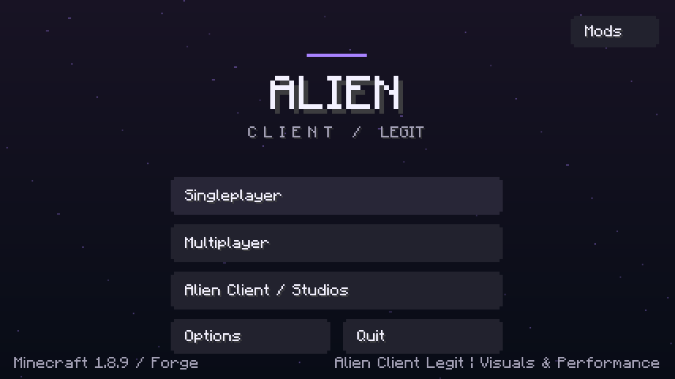

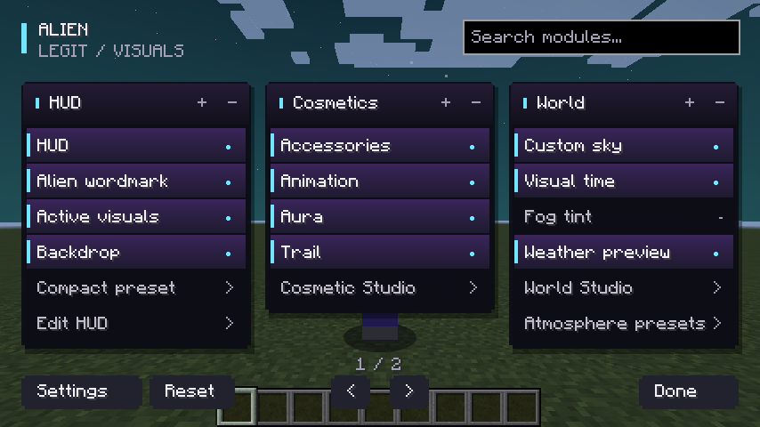

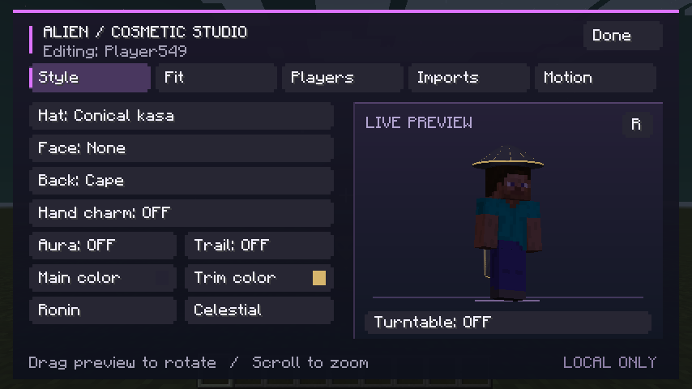

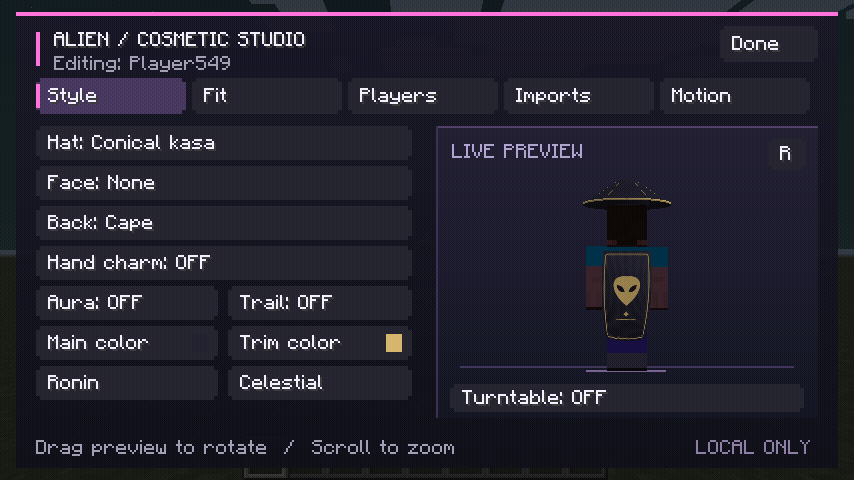

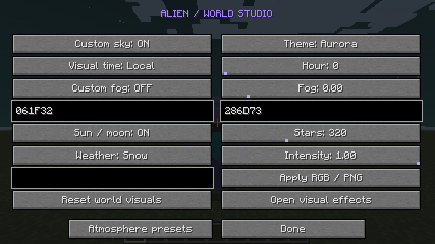

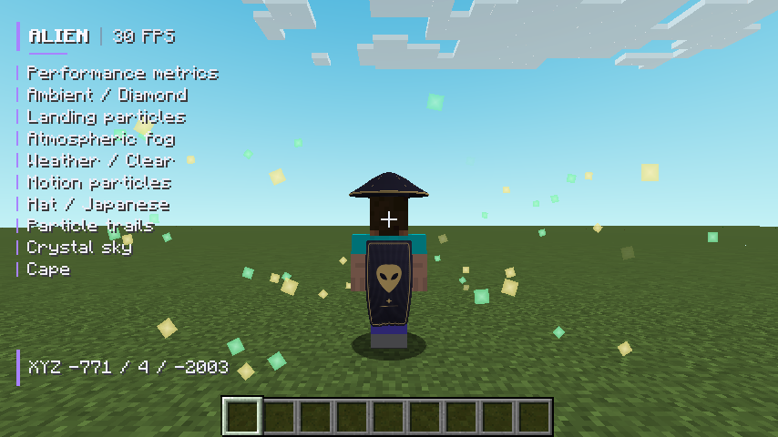

## Full no Minecraft — prévia de arquitetura

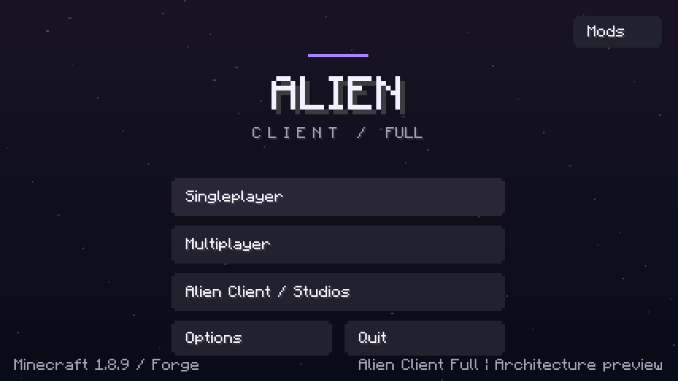

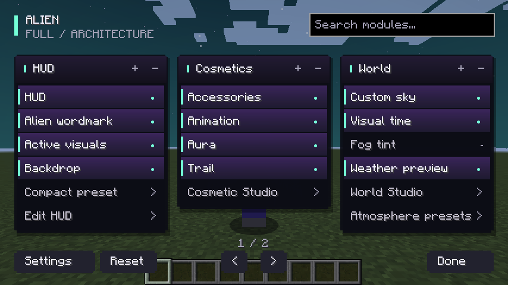

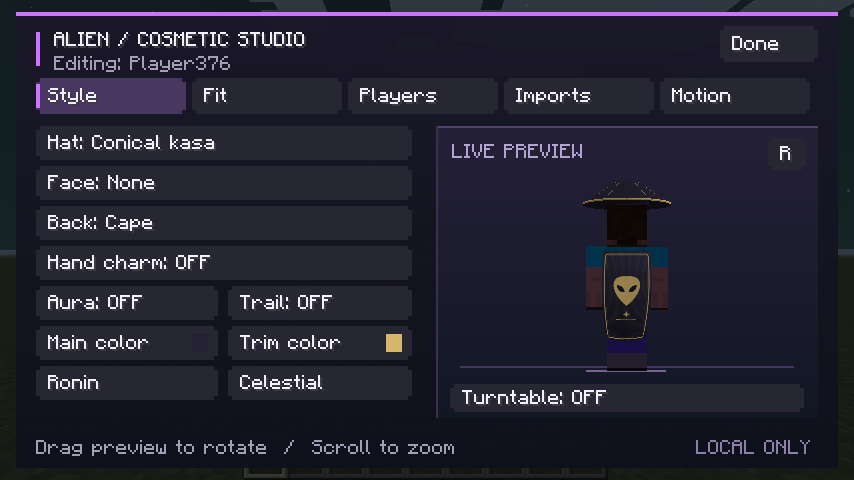

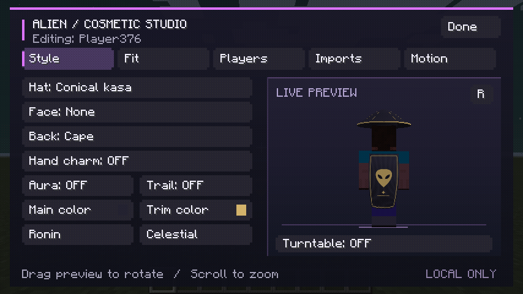

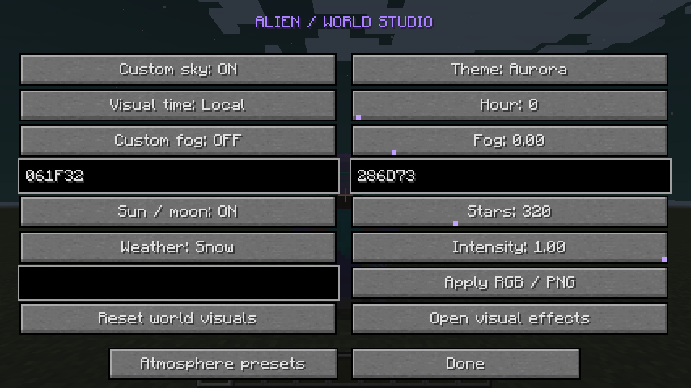

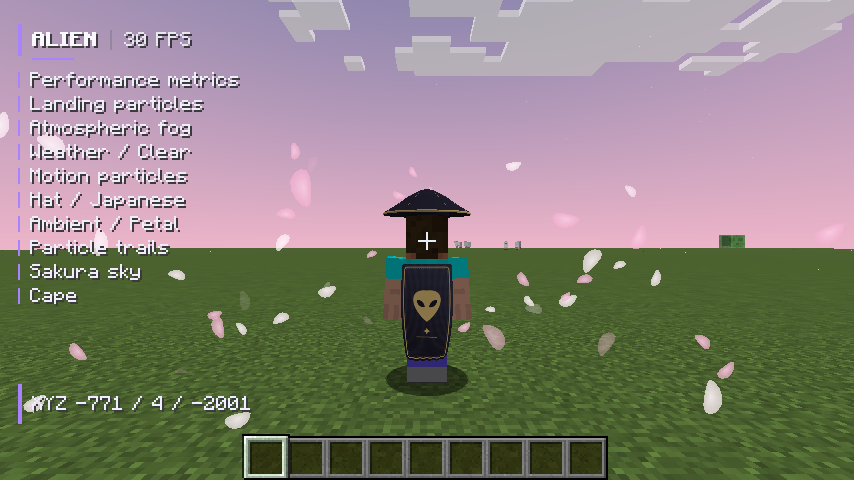

## Procedência e limites

Os GIFs reúnem 12 quadros originais de cada execução, sem interpolação, reproduzidos a 8 quadros/s. A comparação restrita à região do tecido encontrou até [98 pixels alterados na Legit](legit/cape-motion-metrics.txt) e [95 na Full](full/cape-motion-metrics.txt). Os PNGs não receberam retoques; hashes estão nas respectivas pastas.

O jogo foi limitado a 30 FPS. Não é benchmark; multiplayer, launcher externo, OptiFine, áudio e GPUs reais não foram validados. A rodada testa classes atuais de desenvolvimento, separadas por edição, enquanto os JARs foram compilados, reofuscados e inspecionados. [Limitações completas](../../docs/EDITIONS.md).
