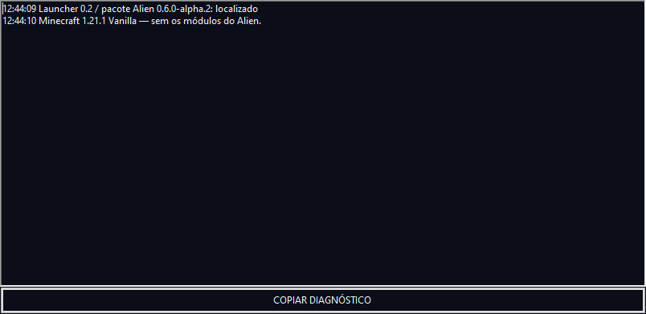
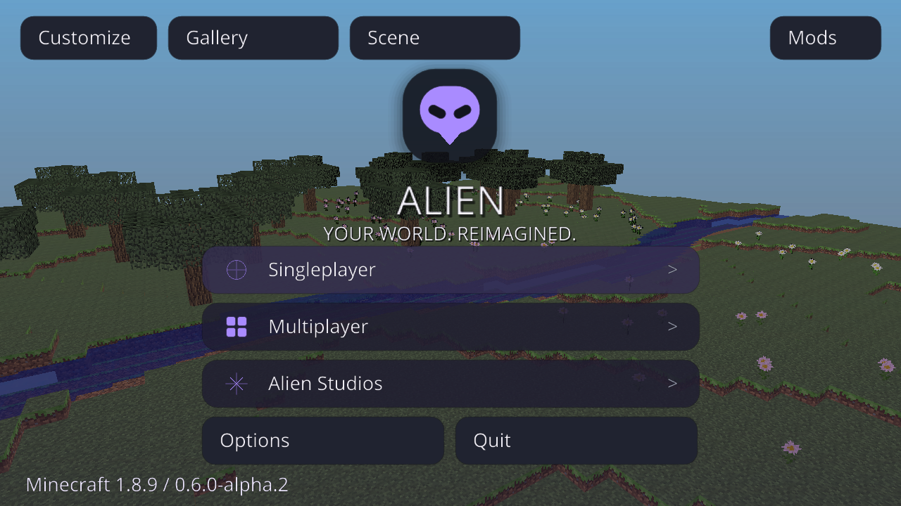

# Alien Launcher — capturas reais atuais

Capturas de **26/10/2026**, launcher **0.2.0-alpha.1 / Unified 0.6.0-alpha.2**. Esta pasta contém somente a rodada atual. [Baixar o launcher](../../downloads/launcher/v0.2.0-alpha.1/README.md) · [Relatório e limites](../../docs/LAUNCHER-VALIDATION.md).

As três primeiras imagens vieram do desktop real do runner **Windows Server 2022**, pela API `Graphics.CopyFromScreen`, às **09:44 no horário da Bahia / 12:44 UTC**. O [CI 40324521453](https://github.com/AttackAlien/Alien-Client/actions/runs/40324521453) abriu a janela de produção, trocou o perfil e abriu o diagnóstico; **38 verificações passaram**. Nenhum login foi fabricado: a conta aparece desconectada. [Metadados originais](windows-captures.json) · [Origem e hashes](manifest.json).

## Launcher — Alien / Forge 1.8.9

## Launcher — Vanilla 1.21.1 independente

## Diagnóstico real

O relógio desta janela usa o fuso UTC do runner. O conteúdo é o log efetivamente registrado pelas ações acima.

## Minecraft aberto pelo núcleo do launcher — Linux

Captura direta do jogo **Forge 1.8.9**, com o JAR de distribuição fixado e Java automático. Execução em Linux/Xvfb/Mesa por um probe de teste separado: usa identidade anônima de desenvolvimento, **sem representar login Microsoft ou gameplay Windows**. O log confirmou `Alien Client 0.6.0-alpha.2 initialized` e o processo permaneceu ativo durante os 20 segundos seguintes, antes de ser encerrado pelo teste.

[Assistir / baixar o vídeo real de inicialização, aproximadamente 30 segundos](05-inicio-forge-linux.mp4). O vídeo inclui o carregamento e o menu, sem simulação ou geração por IA. O [vídeo maior do client](../video-atual/README.md) continua disponível, pois o código Java e seus visuais não foram alterados nesta tarefa.
