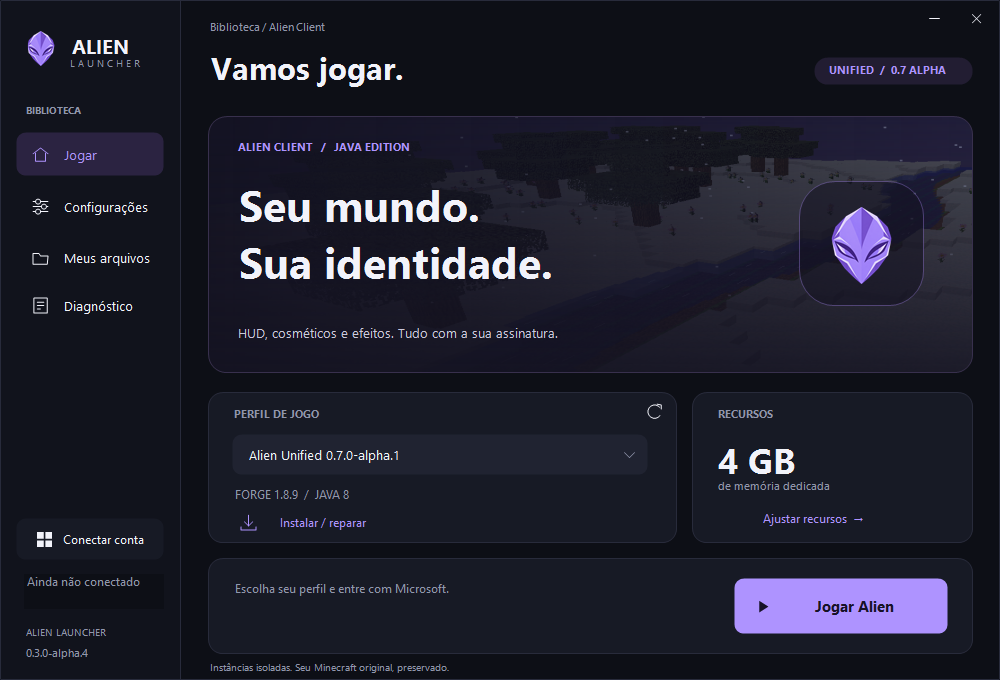
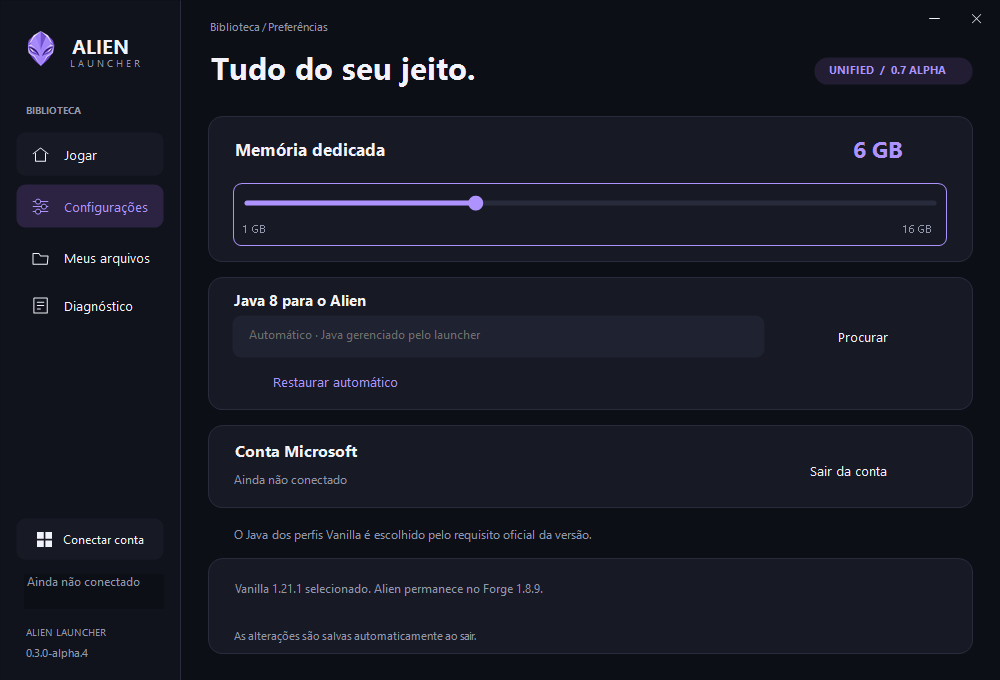
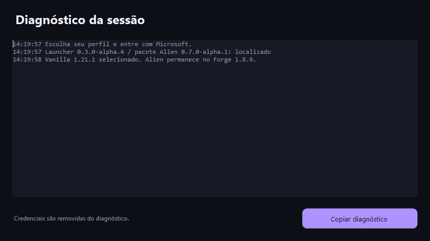

# Launcher 0.3.0-alpha.4 — capturas atuais

**29/10/2026, 11:19 no fuso da Bahia (UTC−3)**. Seis PNGs originais do launcher realmente executado no Windows Server 2022. As fotos anteriores desta pasta foram substituídas. Layout e emblema aprovados foram mantidos.

[Baixar launcher com Trail Studio](../../downloads/launcher/v0.3.0-alpha.4/README.md) · [Resultados](../../docs/TRAIL-STUDIO-VALIDATION.md) · [CI 40890062885](https://github.com/AttackAlien/Alien-Client/actions/runs/40890062885) · [Métodos, origem e hashes](manifest.json) · [190 fotos do Minecraft](../README.md).

## Tela inicial — Unified 0.7.0-alpha.1

## Vanilla independente

## Configurações

## Diagnóstico

## Restauração de Vanilla 1.21.4

## Recuperação de configuração inválida

**31 testes por sistema Linux/Windows e 46 verificações da janela real passaram**, assim como a instalação do Forge/Java 8 com o JAR novo. Os métodos de captura nativa estão registrados em `manifest.json`; esta rodada usa `CopyFromScreen`.

A conta está desconectada; não houve login Microsoft de teste. O cenário do painel é um asset de uma captura anterior do Minecraft. O emblema é arte de marca incorporada ao produto; estes PNGs de evidência são leituras reais do desktop, sem retoques ou geração de imagem.
