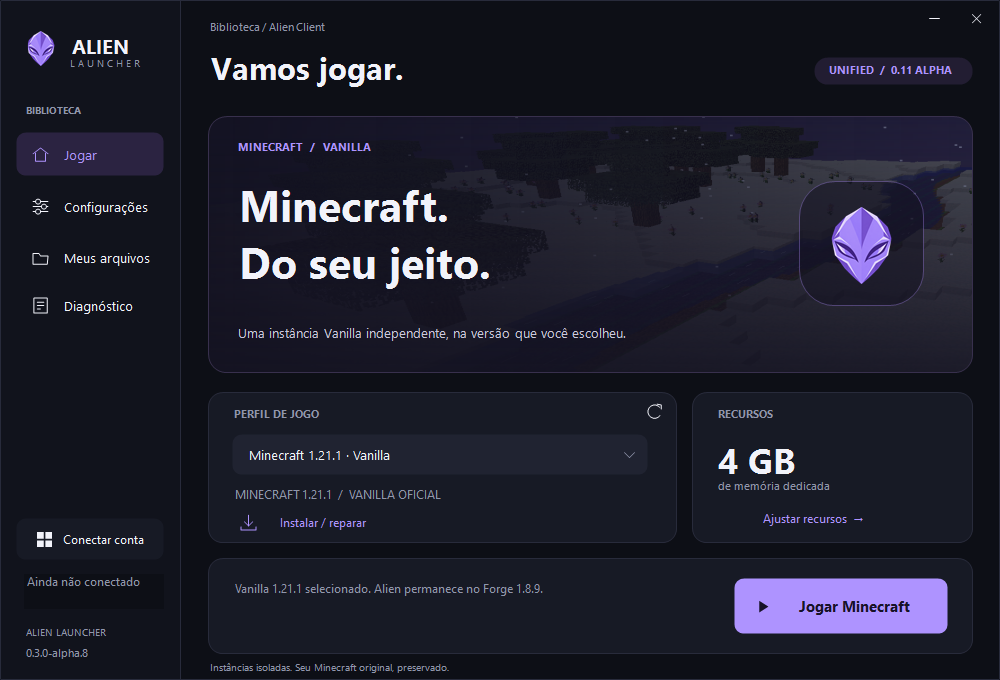
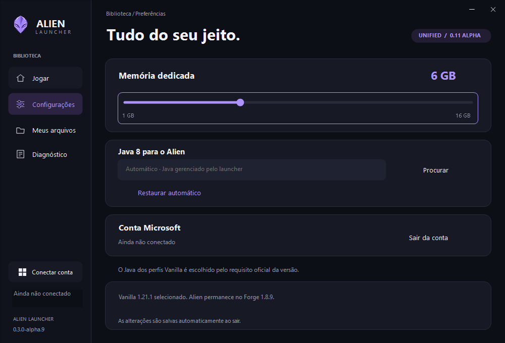
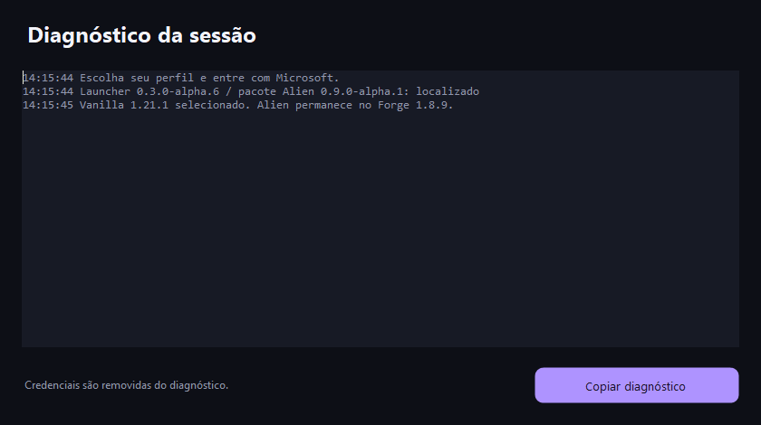

# Launcher 0.3.0-alpha.9 — capturas atuais

Seis PNGs originais da janela WinForms executada no Windows Server 2022 em 05/11/2026, substituindo as imagens anteriores desta pasta. Layout/emblema preservados; o payload agora é o **Unified 0.11.0-alpha.1 com Alien e Tung Tung Sahur**.

31 testes Linux, 31 Windows, 46 checks da janela e instalação isolada aprovados; [workflow 42030955347](https://github.com/AttackAlien/Alien-Client/actions/runs/42030955347) concluído com sucesso.

[Baixar launcher candidato](../../downloads/launcher/v0.3.0-alpha.9/README.md) · [Resultados e limites](../../docs/ANIMATED-MASCOT-VALIDATION.md) · [Métodos/horários/hashes](manifest.json) · [368 fotos novas do Minecraft](../README.md).

## Tela inicial

## Vanilla independente

## Configurações

## Diagnóstico

[Vanilla restaurado ao reabrir](05-launcher-restored-vanilla.png) · [Configuração corrompida recuperada do backup](06-launcher-settings-recovery.png).

Métodos nativos CopyFromScreen/PrintWindow registrados no manifesto. O emblema é arte do produto, preservada; os seis PNGs são capturas da janela real. Login Microsoft e gameplay em Windows físico não foram validados.
