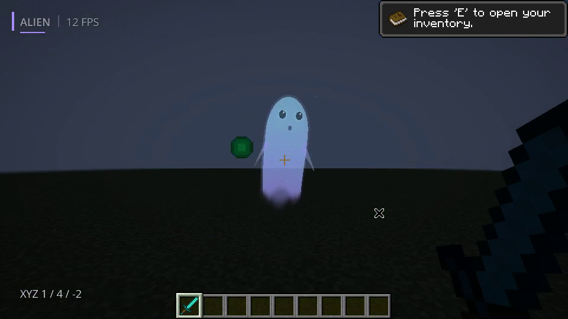

# Vídeo atual — mascote animado, customizações e Full

**[Assistir / baixar MP4](Alien-Client-0.11-customizacoes-full.mp4)** — 123.69s, 960×540, H.264, 29.97 FPS nativos (`30000/1001`), sem áudio. Gravação contínua do Minecraft Forge 1.8.9 em execução, sem sequência de fotos, aceleração, frames gerados ou interpolação.

Mediana medida no jogo: **57.9 FPS**, P95 **28.6 ms/frame** em Linux/Mesa por software. O arquivo é a saída original do FFmpeg, sem reedição. A taxa solicitada foi 30 FPS; o encoder registrou 29,97 e esse valor foi preservado.

## Capítulos aproximados

- 00:00 — Capa animada
- 00:08 — Chapeus e acessorios
- 00:16 — Trilhas desenhadas
- 00:24 — Particulas Sakura
- 00:32 — Ceu realista e nuvens suaves
- 00:40 — HUD Ultimate
- 00:48 — Floss, Orange Justice, Take the L
- 01:00 — Auras reativas
- 01:12 — Modo FULL
- 01:16 — Aimbot - alvo de treino
- 01:22 — Auto Food
- 01:29 — Auto Potion
- 01:36 — AutoBridge
- 01:45 — Mascote alien animado

As legendas identificam uma demonstração automatizada em mundo local descartável. O mascote aparece no último capítulo, a partir de 01:45, acompanhando movimento real, acenando durante Floss e mudando entre Follow, Shoulder e Orbit. O filme também confirma ações reais dos módulos Full em condições preparadas pelo servidor integrado; AutoBridge foi ativado separadamente para seu capítulo.

Fonte `2eef9a5227cff07830300d8d05a6d0b01aacc4a0`. [Recibos e medições](../../docs/mascot-results/2026-11-04/video/) · [SHA-256](SHA256SUMS.txt) · [Guia do mascote](../../docs/ANIMATED-MASCOT.md) · [Resultados](../../docs/ANIMATED-MASCOT-VALIDATION.md).

O filme anterior saiu da pasta atual e permanece no histórico Git. Login Microsoft, multiplayer externo e gameplay em Windows físico não foram validados.
