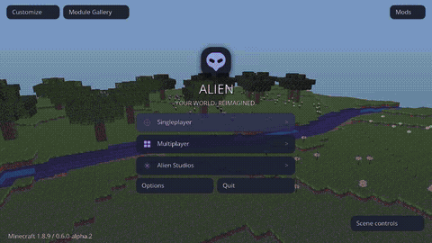

# Vídeo atual — Alien Interactive Studio 0.6.0-alpha.2

Gravação real de **Minecraft Forge 1.8.9**, em **24/10/2026, 21:59–22:05 UTC**, fonte `32829c561b8dc53719a71b7a6621c58cb5a2e8f5`. Seis sessões de testes, com menu e mundos descartáveis, sem áudio/aceleração.

- **[Baixar MP4 — 4min48s, 720p/20 fps, 23.8 MB](https://raw.githubusercontent.com/AttackAlien/Alien-Client/refs/heads/feature/interactive-studio-20261024/captures/video-atual/Alien-Unified-0.6.0-alpha.2-tour-completo.mp4)**. Se o navegador baixar, abra o arquivo no reprodutor do celular/computador.
- **[Abrir GIF — 2min59s, 10.3 MB](https://raw.githubusercontent.com/AttackAlien/Alien-Client/refs/heads/feature/interactive-studio-20261024/captures/video-atual/Alien-Unified-0.6.0-alpha.2-previa.gif)**.
- [154 fotos atuais](../README.md) · [JAR/ZIP](../../downloads/v0.6.0-alpha.2/) · [PR #18](https://github.com/AttackAlien/Alien-Client/pull/18).

Inclui menu interativo e controles, galeria/Orbit/perfis, efeitos novos, céus nomeados e os recursos preservados: HUD/Full, partículas, capas/trilhas/headwear, importação de céu, Scene Studio. É o Alien executado no Forge, com implementações e arte próprias; o vídeo de referência não foi reutilizado nesta mídia.

## Capítulos

| Início | Sessão |
| --- | --- |
| 00:00 | Menus, cosmeticos, temas, mundo e perfis |
| 01:11 | Sky Studio, cubemap e galeria tecnica |
| 01:44 | Combat Studio: mira, clique e perfis |
| 02:06 | HUD Ultimate, Full tools e particulas aprimoradas |
| 03:09 | Scene Studio: nove efeitos visuais inspirados no video |
| 03:50 | Interactive Studio: menu 3D, perfis, efeitos e oito novos estilos de ceu |

Carregamentos e mudanças reais de resolução foram mantidos. Navegação automatizada; pause para ler telas. Atlas com rótulos no Sky smoke são fixtures técnicas de importação, não pacotes artísticos.

## GIF de prévia

69 trechos reais em velocidade normal, cortes secos, 480 px/5 fps/cores reduzidas, sem interpolação de frames.



## Proveniência

[Metadados e seleção dos trechos](proveniencia.json) · [SHA-256](SHA256SUMS.txt) · [Resultados/comandos](../../docs/INTERACTIVE-STUDIO-VALIDATION.md).

**526 checks gráficos**, **175 JUnit por composição**, **11 testes de empacotamento**. Relatórios: [geral](general-result.txt), [céu](sky-result.txt), [combate](combat-result.txt), [HUD/Full](ultimate-result.txt), [Scene](scene-result.txt), [Interactive](studio-result.txt). Mídias anteriores foram substituídas nestas pastas atuais, mantendo histórico no Git.

FFmpeg `x11grab`, Xvfb 1280×720, Mesa por software, Java 8u472. MP4 concatena H.264 das seis sessões sem recodificação ou mudança de velocidade. GIF usa somente frames reais. 20 fps é a taxa de captura, não benchmark do jogo.

```bash
ffmpeg -f x11grab -draw_mouse 0 -framerate 20 -video_size 1280x720 \
  -i :94 -an -c:v libx264 -threads 2 -preset veryfast -crf 22 \
  -pix_fmt yuv420p -movflags +faststart sessao.mp4
```

Tarefas: `runSmokeClient`, `runSkySmokeClient`, `runCombatSmokeClient`, `runUltimateSmokeClient`, `runSceneSmokeClient`, `runStudioSmokeClient`, com `-Pedition=unified`. O init script temporário só fornece `--width 1280 --height 720`.
