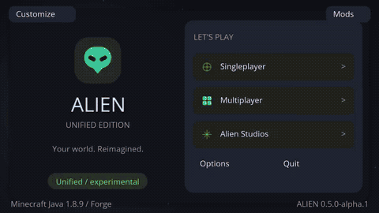

# Vídeo atual — Alien Scene Studio 0.5.0-alpha.1

Gravação real de **Minecraft Forge 1.8.9**, em 24/10/2026, 16:53–16:57 UTC, fonte `3a8ee39413c8309168a13ee3a6295e0b4b68e3b6`. Cinco sessões automatizadas de teste em mundos descartáveis, sem áudio ou aceleração.

- **[Baixar MP4 — 3min48s, 720p/20 fps, aproximadamente 18 MB](https://raw.githubusercontent.com/AttackAlien/Alien-Client/refs/heads/feature/visual-scenes-20261024/captures/video-atual/Alien-Unified-tour-completo.mp4)**. Abra o arquivo no reprodutor do celular/computador se o navegador baixar em vez de reproduzir.
- **[Abrir GIF — 2min15s, aproximadamente 8,8 MB](https://raw.githubusercontent.com/AttackAlien/Alien-Client/refs/heads/feature/visual-scenes-20261024/captures/video-atual/Alien-Unified-previa.gif)**.
- [117 fotos atuais](../README.md) · [JAR/ZIP de teste](../../downloads/v0.5.0-alpha.1/) · [PR #17](https://github.com/AttackAlien/Alien-Client/pull/17).

O vídeo cobre o client preservado e os nove recursos identificados no TikTok: Shockwave, capa animada, Trail, Cute World, Cyberspace, esqueleto X-Ray, Glass, Chroma e oito céus animados. As implementações têm arte e shaders originais Alien. Não é o vídeo Purxiy reeditado.

## Capítulos

| Início | Sessão |
| --- | --- |
| 00:00 | Menus, cosmeticos, temas, mundo e perfis |
| 01:08 | Sky Studio, cubemap e galeria tecnica |
| 01:42 | Combat Studio: mira, clique e perfis |
| 02:03 | HUD Ultimate, Full tools e particulas aprimoradas |
| 03:07 | Scene Studio: nove efeitos visuais inspirados no video |

Os capítulos incluem os carregamentos reais e mudanças de resolução dos testes. A navegação é automatizada e rápida; pause para ler as telas. Os atlas de cubemap são imagens técnicas de teste, identificadas no relatório; não são pacotes artísticos de céu.

## GIF de prévia

45 trechos reais do mesmo vídeo em velocidade normal, com cortes secos, 480 px e 5 fps/cores reduzidas, sem interpolação de frames.



## Proveniência

[Metadados/seleção dos trechos](proveniencia.json) · [SHA-256](SHA256SUMS.txt) · [Validação e comandos](../../docs/VISUAL-SCENES-VALIDATION.md).

Cinco sessões aprovadas: [geral 161](general-result.txt), [céu 37](sky-result.txt), [combate 24](combat-result.txt), [HUD/Full/cosméticos 92](ultimate-result.txt), [Scene Studio 70](scene-result.txt). JUnit: 165 por composição; pacote validado e vinculado ao mesmo código. Os PNGs, GIF e MP4 anteriores foram substituídos nestes diretórios atuais, mantendo o histórico no Git.

Captura FFmpeg `x11grab`, Xvfb 1280×720, Mesa por software e Java 8. O MP4 concatena streams H.264 das cinco gravações, sem recodificação. O GIF usa somente frames reais selecionados. A taxa de captura de 20 fps não é um benchmark de FPS do jogo.

```bash
ffmpeg -f x11grab -draw_mouse 0 -framerate 20 -video_size 1280x720 \
  -i :94 -an -c:v libx264 -threads 2 -preset veryfast -crf 22 \
  -pix_fmt yuv420p -movflags +faststart sessao.mp4
```

As tarefas gravadas foram `runSmokeClient`, `runSkySmokeClient`, `runCombatSmokeClient`, `runUltimateSmokeClient` e `runSceneSmokeClient`, com `-Pedition=unified`. O init script temporário apenas acrescentou os argumentos iniciais `--width 1280 --height 720`.
