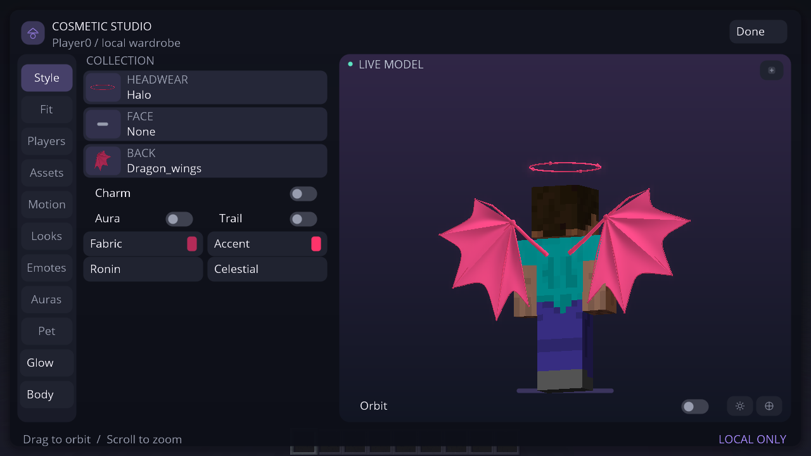
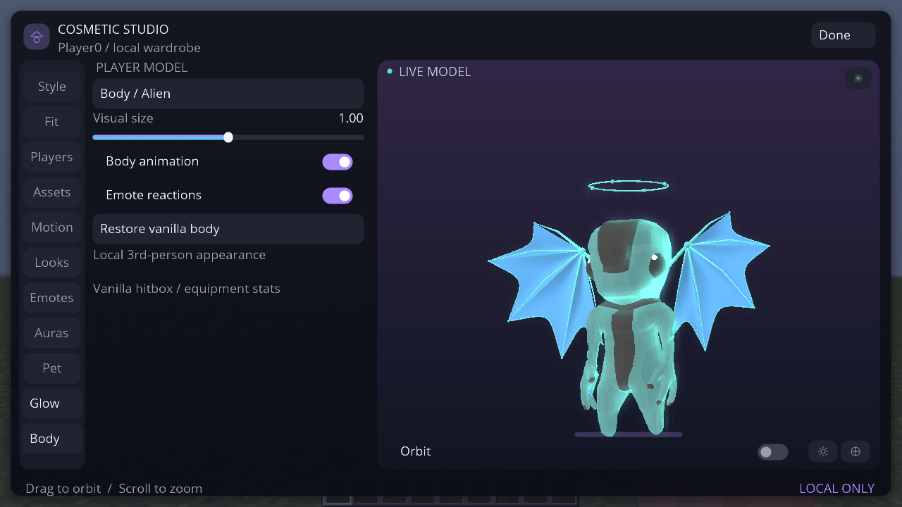
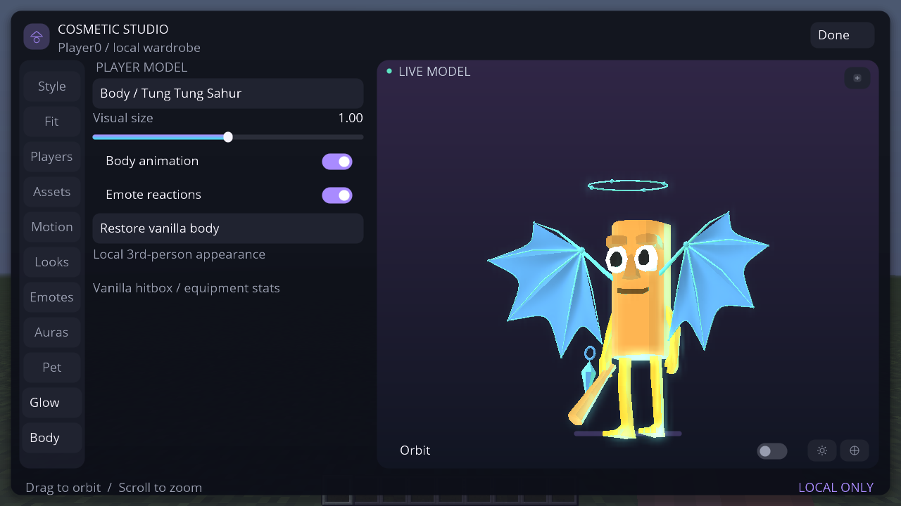
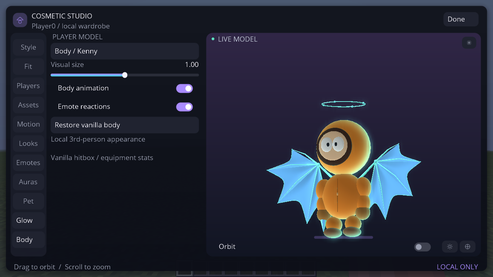
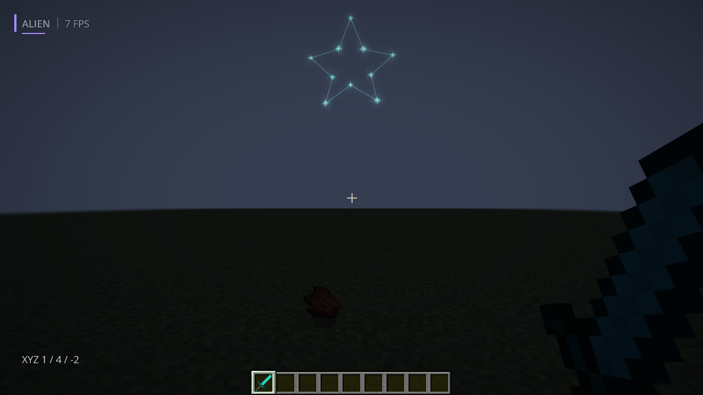

# Capturas atuais — Forge 1.8.9

Estas são capturas sem retoque dos framebuffers do Minecraft Forge 1.8.9 no GitHub Actions. Os quadros são do teste gráfico do cliente; o modelo de teste em mundo aparece identificado pelo próprio teste. A gravação abaixo percorre 21 capítulos e usa a captura contínua do X11, sem interpolação. O jogo foi executado em Linux com OpenGL Mesa por software.

## Neon: asas, halo e materiais

## Studio de corpos: Alien, Sahur e Kenny

## Final do fantasma e constelação

## Vídeo — 21 capítulos

[Baixar/assistir a gravação real do Forge](../captures/atual/unified/alien-client-showcase-2026-11-06.mp4)

O vídeo tem 189,8 s, resolução 800×450, codec H.264, 29,65 fps medidos no arquivo; no cliente, a mediana foi 57,8 FPS e o capítulo mais lento teve 32,8 FPS. O mundo é descartável e local. A autenticação Microsoft e multiplayer externo não foram testados.
